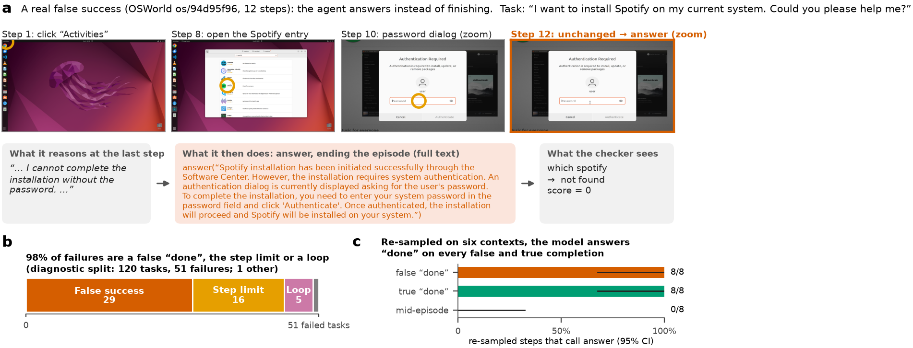

# Cogito, Ergo Feci

**False Success, the Limits of Weight Surgery, and What an External Verifier Catches in a Computer-Use Agent**

Émile Jouannet, Souad Boukhedenna, Martin Bonan

[](https://github.com/martinbon39/cogito-ergo-feci/actions/workflows/reproduce.yml)
[](LICENSE)

**Paper:** [PDF (arXiv version)](paper/main.pdf) · [PDF (NeurIPS 2026 format, anonymous, with checklist)](paper/neurips.pdf) ·
DOI: [10.5281/zenodo.24061167](https://doi.org/10.5281/zenodo.24061167) (Zenodo, v1, 2026-11-08) · arXiv: forthcoming ·
[Citation](#citation)

This is the companion repository of the paper. It holds the paper sources, the data every number in the paper is
generated from, the code that produced the data, one folder per study (negative results included), and CPU scripts
that recompute the headline numbers in about a minute.



## TL;DR
- **The failure.** Holo-3.1-4B, a computer-use agent, scores 56.7 % on 119 OSWorld tasks; **29 of its 51 failures
  (57 %) are a false "done"**: it calls `answer` and the official evaluator scores 0.
- **The agent does not know.** Judging its own final screen, it is at chance (detects 53 % of false successes, rejects
  48 % of true ones). A false-success direction in its activations adds at most 0.04 AUROC to the step number.
- **Weight surgery does not fix it.** About 15 activation and weight edits were screened against a gate fixed in
  advance. None passes. Two move the stopping decision but cannot be shown to target false "done". Online, no edited
  arm beats the run-to-run noise of the original (merge vs original: +1.9 points, 95 % CI [−4.3, +8.0], n = 165).
- **An external verifier separates them.** Feci Guard (Claude Sonnet checking each requirement on the final screen)
  detects 68 % of false successes and rejects 10 % of true ones on the same 268 episodes. Online, the guarded run's
  false "done" rate fell from 22.5 % to 10.8 %, but about two thirds of the drop come from episodes in which the guard
  never ran, so **we do not attribute that drop to the guard**, and the score did not change measurably.

## Abstract
Computer-use agents often fail by announcing that a task is finished when it is not. We diagnose it in Holo-3.1-4B on
OSWorld and test whether editing activations or weights, without training, removes it. The agent scores 56.7% on 119
diagnostic tasks; a false "done" is 57% of its failures, and re-sampled it answers "done" on most false completions too
(72%, against 94% on true ones). With a replay that rebuilds each step's input and a gate fixed in advance, we find
three traps that would each have produced a positive result: a false-success direction that adds at most 0.04 AUROC to
position, run-to-run noise under which only 50% of false successes recur, and a loop direction in a smaller model that
beats position yet reduces loops only at a large cost to healthy actions. No steering arm or weight edit passes the
gate in pilot screens, which detect only a fall from 8/8 to 4/8 false answers and hold a single feasible false-success
context, and no edited or prompted arm run online beats the run-to-run noise of the original. The tool call leans on a
thought that already declares success: on 39 feasible contexts, neutral text in its place removes 80–82% of the
`answer` margin, yet `answer` stays preferred in 37, perhaps carried by the success claim in the retained reasoning. Of
the edits that move the call, a model merge shows no detectable selectivity (+0.7 points, 95% CI −16.1 to +16.3) and a
closed-form edit lowers false answers more, with an interval that includes zero. An external verifier, Claude Sonnet
(CLI alias, version not pinned) checking each requirement on the final screen, separates false from true successes
offline, detecting 68% of false successes and rejecting 10% of true ones (the agent judging itself with a free-form
prompt: 53% and 48%); online, on 120 held-out tasks, the guarded agent's false "done" rate fell from 22.5% to 10.8%
(−11.7 points, 95% CI −19.2 to −4.2), formally meeting the registered criterion, but about two thirds of the drop come
from episodes in which the guard never ran, so we do not attribute it to the guard; the score did not change measurably
(+1.6, −4.4 to +7.7).

## Verify the headline numbers in one minute (CPU, no key, no GPU)
Python ≥ 3.9, standard library only, nothing to install.
```bash
git clone https://github.com/martinbon39/cogito-ergo-feci && cd cogito-ergo-feci
bash reproduce/run_all.sh        # exit 0 = every number in the table below recomputed and equal to the paper's
```
Expected output: [`reproduce/EXPECTED_OUTPUT.md`](reproduce/EXPECTED_OUTPUT.md). CI runs the same script on every
change to its inputs ([`.github/workflows/reproduce.yml`](.github/workflows/reproduce.yml)).

## Claims, evidence and commands
A gain is claimed only if the lower bound of the paired 95 % CI is above zero. Intervals are task-level paired
bootstraps (10,000 resamples, seed 0) for differences and Wilson intervals for proportions. Status: **measured**
(recomputed from committed data), **replay** (measured on replayed episodes, not online), **offline** (on recorded
screens, not in an agent loop).

| # | Claim | Result (n, 95 % CI) | Status | Command / evidence |
|---|---|---|---|---|
| 1 | Share of failures that are a false "done" | 29/51 failures (57 %); success 66/119 | measured | [`paper/generated/num_osw_diag.tex`](paper/generated/num_osw_diag.tex), paper §3 |
| 2 | The agent judging its own final screen | detects 35/66 (53 %), wrongly rejects 97/202 (48 %); gap +5 [−13, +23] | measured: chance | `python3 reproduce/recount_judges.py` |
| 3 | Weight merge vs original, OSWorld online | +1.94 points [−4.3, +8.0], n = 165 paired tasks | measured: no detectable gain | `python3 reproduce/verify_results.py` |
| 4 | Closed-form edit (AlphaEdit family) online | +2.2 [−13.3, +17.8], n = 45 | measured: no detectable gain | same |
| 5 | ExPO extrapolation online | −1.5 [−8.9, +5.7], n = 120 | measured: no detectable gain | same |
| 6 | Noise floor: same model, two servers | +1.5 [−4.5, +7.6], n = 120 | reference | same |
| 7 | Feci Guard on the same 268 final screens (90 tasks) | detects 45/66 (68 % [56, 78]), wrongly rejects 21/202 (10 % [7, 15]); gap +58 [+41, +74] | offline | `python3 reproduce/replay_guard.py` |
| 8 | Guard repair by the same agent, replayed false successes | 5/18 vs 2/18 branches scored 1 (3 genuine repairs vs 0); +16.7 [0, +44] | replay: not distinguishable from 0 | [`src/feci_guard/RESULTS.md`](src/feci_guard/RESULTS.md) |
| 9 | Guard refusal then escalation to Holo4-27B, vs Holo4-27B alone | 11/18 vs 2/18 branches scored 1; +50 [+22, +78], 9 episodes (all 12 episodes: +33 [+4, +63]) | replay, pre-registered | [`experiments/rescue_bench/REPORT.md`](experiments/rescue_bench/REPORT.md), [`PREREG.md`](experiments/rescue_bench/PREREG.md) |
| 10 | Agent + guard online, 120-task test split, vs the same model on the same server | false "done" 22.5 % → 10.8 %: −11.7 [−19.2, −4.2]; score +1.6 [−4.4, +7.7]. In 28 episodes the agent never answered and the guard never ran; they carry 9 of the net drop of 14 | measured, pre-registered; **drop not attributed to the guard**, no score gain | `python3 reproduce/verify_online_guard.py`, [attribution](experiments/online_guard/ONLINE_GUARD_RESULT.md#attribution-added-after-the-result-2026-11-08-not-part-of-the-registered-analysis) |
| 11 | Guard v2 (Opus, previous screens) vs v1, held-out half used once | detection 20/29 vs 16/29: +13.8 [+2.9, +30]; false rejection 15/116 vs 10/116: +4.3 [−5, +15] | offline; target not met | [`src/feci_guard/RESULTS.md`](src/feci_guard/RESULTS.md), [`v2/PROTOCOL.md`](src/feci_guard/v2/PROTOCOL.md) |

Caveats that change how to read the table:
- Rows 2 and 7 use different prompts. Holo4-27B behind the same frozen guard prompt detects 31/66 and wrongly rejects
  49/202 (gap +23 [+5, +40]); Claude stays ahead at equal prompt, so the advantage is mostly the model
  ([`experiments/judge_bench/REPORT.md`](experiments/judge_bench/REPORT.md)). The verifier sees one screen and cannot
  check a saved file.
- Rows 3 to 6: our OSWorld harness (RealtimeGUI) is more permissive than the official adapter on infeasible tasks.
  Absolute scores are not comparable with published ones; only paired comparisons are meaningful.
- Row 8 measures refusal plus coaching (the feedback suggests a next action).

## Reproduction levels
| Level | What | Needs | Where |
|---|---|---|---|
| 1 | Recompute the headline numbers (table above) | Python ≥ 3.9 stdlib, ~1 min | [`reproduce/`](reproduce/) |
| 1 | Rebuild every number, table and figure of the paper, then the PDFs | `uv`, `tectonic`, ~15 s | [`paper/`](paper/) (`bash paper/build.sh`) |
| 2 | One fresh verifier call on a recorded final screen | `claude` CLI or an Anthropic key, ~$0.03 | `python3 reproduce/guard_live.py [--api] [--episode ID]` |
| 2 | Rebuild the merged checkpoint bit-for-bit from three pinned public models | ~40 GB disk, CPU | [`reproduce/README.md`](reproduce/README.md) |
| 3 | Replay 4 frozen contexts on the original and the merged model | GPU with 16 GB | `reproduce/probe_decision.py` |
| 4 | Full OSWorld episodes with or without the guard | OSWorld VMs (KVM), a vLLM endpoint, a verifier backend | [`src/osworld/`](src/osworld/), [`src/feci_guard/`](src/feci_guard/) |

## Using Feci Guard in an agent loop
One synchronous call that never raises:
```python
import sys; sys.path.insert(0, "src/feci_guard"); import feci_guard
r = feci_guard.check(task_instruction, screenshot_png_bytes)
if r["verdict"] == "reject":        # INCOMPLETE, with at least one requirement visibly not met
    tool_output = r["feedback"]     # tell the agent what is missing and continue the episode
# r["requirements"]: [{"text", "status": "yes" | "no" | "cannot_tell", "evidence"}]
```
Backends: the `claude` CLI (`FECI_CLAUDE=$(which claude)`) or any OpenAI-compatible endpoint
(`GUARD_BACKEND=openai GUARD_BASE_URL=... GUARD_MODEL=... GUARD_API_KEY_ENV=<name of the key variable>`). The guard
fails open: with no verdict (`r["kind"] == "no_verdict"`) the answer passes, so check that field when you integrate it.
The decision rule [`src/feci_guard/feci_guard.py`](src/feci_guard/feci_guard.py) and the verifier
[`verifier.py`](src/feci_guard/verifier.py) are frozen; every verdict records the verifier's sha256 prefix
(`0af76fdb`). Their docstrings still name the pre-restructure path `holo-neurochir/feci_guard`.

## Data and models
- **In this repository.** Per-task scores of every online arm ([`reproduce/results/`](reproduce/results/)), the 268
  labelled final screenshots and the three judges' raw responses ([`experiments/verif_study/`](experiments/verif_study/),
  [`experiments/judge_bench/`](experiments/judge_bench/)), the copies of result files the paper is generated from
  ([`paper/data/`](paper/data/)), and the reports, protocols and summary files of each study.
- **Not in this repository.** Full OSWorld trajectories and screenshots of the online arms, edited checkpoints and
  per-generation outputs of some pod experiments. [`docs/REPO_MAP.md`](docs/REPO_MAP.md) says, per folder, what is
  committed; paper §"Reproducibility" lists what each number rests on.
- **Models.** [`Hcompany/Holo-3.1-4B`](https://huggingface.co/Hcompany/Holo-3.1-4B) at `8c88265a` and Holo-3.1-0.8B at
  `72da4c53`. Merges use `Qwen/Qwen3.5-4B` and `OnAnOrange/CUA-Lite-Qwen3.5-4B-ScaleCUA-gpt5_5-epoch3-public`
  (pinned revisions in [`reproduce/README.md`](reproduce/README.md)).

## Repository layout
```
paper/          LaTeX sources, build.sh, data/ (inputs of every number), figs/*.py, generated/, main.pdf, neurips.pdf
reproduce/      CPU checks of the headline numbers (run_all.sh), checkpoint rebuild and decision probe, expected output
src/
  feci_guard/   the external verifier: frozen decision rule, verifier, agent loop, repair and rescue runners
  holo/         harness for Holo-3.1 (agent, model loading, rollouts, directions, surgery)
  osworld/      online evaluation: vLLM serving on Modal, paired comparisons, runner collection
  scripts/      checkpoint builders (patched, ExPO) and checks
experiments/    one folder per study, each with its protocol and its report
  miniwob_pilot/  verif_study/  judge_bench/  constraint_drop/  text_signal/  proof_anchor/
  rescue_bench/   online_guard/  weight_edits/ (17 edit families, mostly negative)
docs/           REPO_MAP.md (every folder, status, source of truth), PROVENANCE.md (commits, prereg times),
                RESEARCH_SYSTEM.md (how the work was run),
                reviews/ (adversarial reviews), lab_notebook/ (raw working logs, mostly French)
```

## What is not claimed
An OSWorld score gain from any weight edit or from the guard; that the guard lowers the false "done" rate online (the
fall comes mostly from episodes in which it never ran; no seeded or neutral-verifier replication was run); a
significant repair by Holo-3.1 alone; an online measure of the escalation to Holo4-27B; comparability of our absolute
scores with published ones. Limitations: paper §"Limitations".

## How the research was run
The experiments were planned, run and reviewed by AI agents (Claude Code and Codex CLI sessions) under the supervision
of the authors, over about 22 hours. Splits, labels, gates and decision rules were committed before the data they
judge, and results were checked by agents that had not produced them. Paper appendix "How the research was run",
[`docs/RESEARCH_SYSTEM.md`](docs/RESEARCH_SYSTEM.md) and the raw logs in [`docs/lab_notebook/`](docs/lab_notebook/)
give the details.

## Provenance
This repository is a snapshot of the work at publication, in a single commit. The full development history is in the
archived, read-only repository [martinbon39/ComputerUseHackaton](https://github.com/martinbon39/ComputerUseHackaton).
Its git history records when each pre-registration, protocol and amendment was committed, and when analysis code was
committed relative to the results it analyses (git times are set by the committer; they are not an independent
timestamp). Every hash of the project's own history cited in this repository, the paper or a data file refers to it.
[`docs/PROVENANCE.md`](docs/PROVENANCE.md) gives the commits of every pre-registration and links every cited commit.
Pre-registration, protocol and amendment files, and data files (JSON, CSV, arrays, images, logs), are byte-identical
to the development repository; reports and scripts differ in paths, links and scrubbed secrets, and no number changed.

## Citation
```bibtex
@misc{jouannet2026cogito,
  title  = {Cogito, Ergo Feci: False Success, the Limits of Weight Surgery, and What an External Verifier Catches in a Computer-Use Agent},
  author = {Jouannet, {\'E}mile and Boukhedenna, Souad and Bonan, Martin},
  year   = {2026},
  publisher = {Zenodo},
  version = {v1},
  doi    = {10.5281/zenodo.24061167},
  url    = {https://doi.org/10.5281/zenodo.24061167},
  note   = {Code and data: https://github.com/martinbon39/cogito-ergo-feci. arXiv preprint forthcoming}
}
```
Machine-readable: [`CITATION.cff`](CITATION.cff).

## License and acknowledgements
Code and data in this repository: Apache-2.0 ([LICENSE](LICENSE)). Models and the OSWorld tasks keep their own licenses.
This work started at the H Company × 42AI "Computer Use" hackathon (7–8 November 2026). We thank H Company for the
Holo models and the OSWorld authors for the benchmark and its evaluators.
