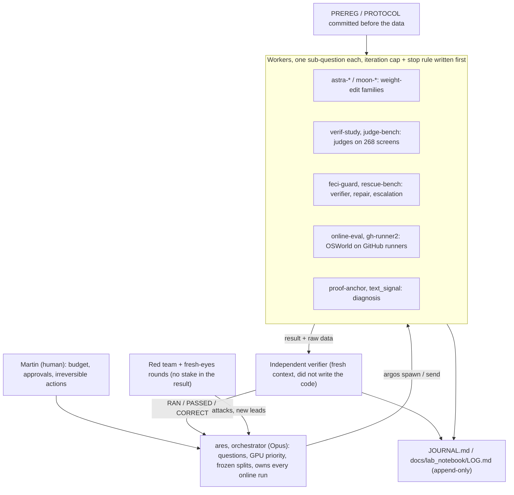
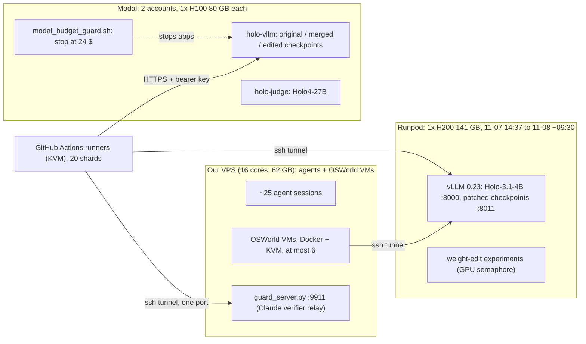
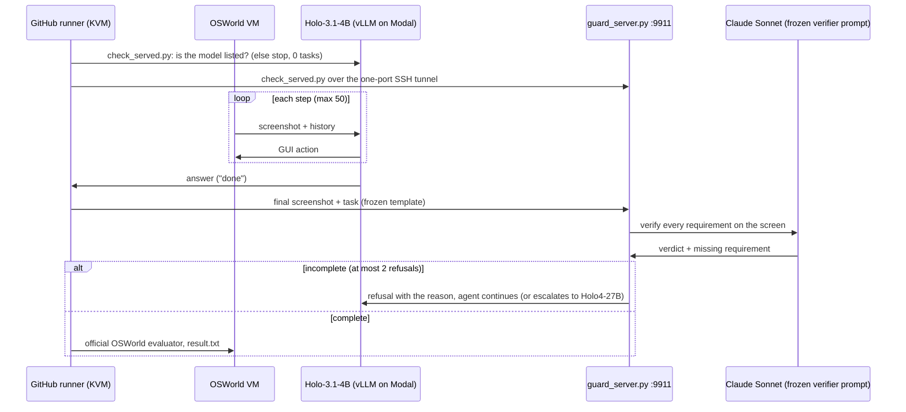
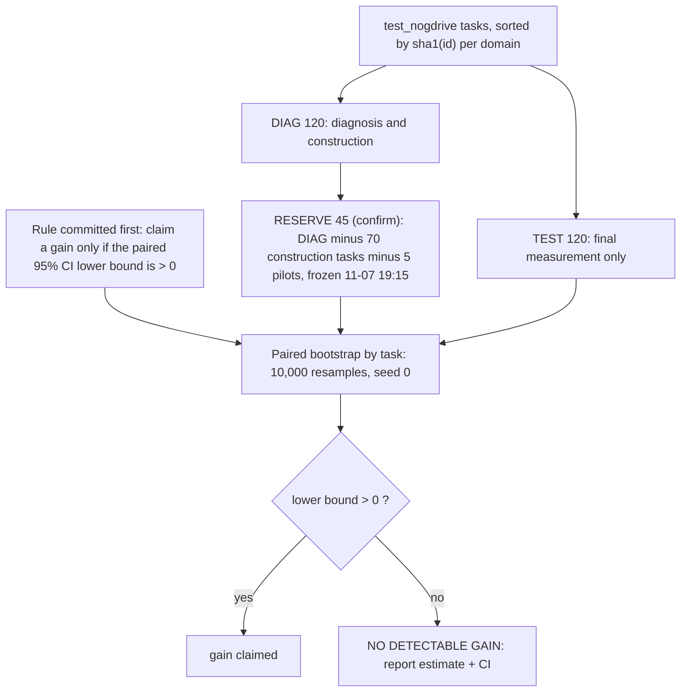

# The research system behind Feci Guard

This page describes **how** the research was done. It covers the team of AI agents, the compute, the OSWorld virtual
machines, the statistics, what happened during the night, and how to reproduce each level. The results themselves
and the claim → evidence → command table are in [README.md](../README.md).

**How to read this page.** Each number is followed by the file it comes from, as `path:line`. Paths are relative to
the repository root. The line numbers are those of `main` at commit [`407b672`](https://github.com/martinbon39/ComputerUseHackaton/commit/407b67269faae8d5eb6a7de6c60c0d144c3b11c1) (2026-11-08) of the development repository ([PROVENANCE.md](PROVENANCE.md)); the paths were updated to the current layout
([REPO_MAP.md](REPO_MAP.md) maps old to new), and the counts that cite `docs/REPO_MAP.md` refer to its version at that commit. Most working notes are in
French (`JOURNAL.md`, `docs/lab_notebook/LOG.md`), so quoted strings are in French and translated inline. A few counts come from the raw
episode folders on our server (`~/osw/`, not in the repo); those are marked **server-only**, with the command that
produced them.

## At a glance

| What | Number | Source |
|---|---|---|
| Agent sessions coordinated by one orchestrator | "~25 agents" | `docs/lab_notebook/LOG.md:481-484` |
| Pre-registration / protocol files committed | 32 (incl. copies under `paper/data/`) | `git ls-files '*PROTOCOL*.md' '*PREREG*.md' '*AMENDMENT*.md'` |
| Review / verification / audit / red-team files committed | 91 | `git ls-files '*.md' \| grep -iE 'review\|verify\|audit\|redteam'` |
| Weight-edit experiment folders closed NEGATIVE | 15 | `docs/REPO_MAP.md` (status column) |
| Per-task scored OSWorld episodes used by the paired statistics | 660 rows (8 arm × split runs) | `reproduce/results/scores.csv` (`wc -l` = 661 with header) |
| Raw OSWorld `result.txt` files on the server (all runs, incl. invalid/partial) | 1288 | **server-only**: `find ~/osw -name result.txt \| wc -l` |
| GitHub Actions runs of the OSWorld runner | 33 (19 success, 9 failure, 4 cancelled, 1 in progress at 10:32 UTC) | `gh run list -R martinbon39/holo-osworld-runner --limit 1000` |
| Final screens labelled for the offline judge bench | 268 (66 false "done", 202 true) | `experiments/judge_bench/REPORT.md:1-4` |
| GPUs | 1× H200 141 GB (Runpod), 1× H100 80 GB per Modal account (2 accounts) | `docs/lab_notebook/JOURNAL.md:75-79`, `src/osworld/modal_vllm.py:88` |
| Recorded spend | Modal 16.80 $ + 17.32 $ (08:35 UTC); Claude judge bench 7.60 $; Runpod at 5.29 $/h (no billing total recorded) | `src/osworld/MODAL_COST.md:25`, `experiments/judge_bench/REPORT.md:60`, `docs/lab_notebook/JOURNAL.md:75` |

---

## 1. The agent team

A team of three supervised: Martin Bonan (research lead, day-to-day supervision of the agent fleet), Émile Jouannet (senior researcher, compute and Modal infrastructure) and Souad Boukhedenna (senior researcher, communication). The work was done by Claude Code (and some Codex) sessions on one server, linked on a
supervision canvas ("argos"). Sessions talked to each other with two commands: `argos read <name>` reads another
session's terminal without interrupting it, and `argos send <name> "…"` writes into it.

**Orchestrator.** `ares`, an Opus session (`docs/lab_notebook/JOURNAL.md:90`); it froze the splits and owned the online runs (`README.md`, "How we worked"). Its log entry describes the scope as
coordinating "~25 agents (Astra codex, Claude)" with the goal "+10 points prouvés sur OSWorld par édition des poids
seule" ("+10 proven points on OSWorld from weight edits alone") (`docs/lab_notebook/LOG.md:481-484`). The goal was not reached, and
the repo says so.

**Workers.** Each worker owned one folder and one question. A worker folder states its owner and session (for example
`experiments/weight_edits/alphaedit_broad/OWNER.md:3`). The list of folders with their final status (RESULT, NEGATIVE, IN PROGRESS)
and their source-of-truth file is [docs/REPO_MAP.md](REPO_MAP.md). Weight-edit workers ran on the GPU pod; their
summaries were copied back from the pod for the paper (`paper/data/pod_astra/`).

**Pre-registration before each measurement.** Gates and decision rules were committed before the data they judge.
Amendments are dated and say what had been seen when they were written.

| File | Written / committed (2026-11-08 UTC) | What it froze |
|---|---|---|
| `src/feci_guard/PREREG.md` | "written 07:36, before opening any blind packet" (line 1); commit [`aa5907f`](https://github.com/martinbon39/ComputerUseHackaton/commit/aa5907f231ed5051c1331167883d5fa21c741022) | verifier hash and decision rule of the Guard |
| `experiments/verif_study/PROTOCOL.md` | "Registered … before model responses" (line 3); commit [`cc671d3`](https://github.com/martinbon39/ComputerUseHackaton/commit/cc671d3071949103c3cf1f8eef300d447fe200fc) | Holo as its own verifier; labels = official `result.txt` (line 9) |
| `experiments/proof_anchor/PROTOCOL.md` | commit [`ff16267`](https://github.com/martinbon39/ComputerUseHackaton/commit/ff16267d9f55a4a97734a74050a33039124961bb) | 39-context anchoring study |
| `experiments/online_guard/PREREG_ONLINE_GUARD.md` | 09:27 "avant tout lancement" (before any launch) (line 1); amendments at 09:28 (line 15), 09:40 (line 29) and 10:44 (line 37) | online Guard arms, primary criterion, benefit/cost rule |
| `src/feci_guard/v2/PROTOCOL.md` | 09:31, held-out half used once | Guard v2 vs v1 |
| `paper/data/local/rescue_bench/PREREG.md` | "registered … before any Holo4 sample" | escalation to Holo4-27B |
| 10 weight-edit `PROTOCOL.md` files (`astra-*`, `moon-*`) plus `moon-vision/PROTOCOL_v1.md` | before each lot | gates, budgets, stop rules |

The decision rule of the primary weight-edit test was written at 03:36, "RÈGLE DE DÉCISION fixée AVANT de lire les
résultats" ("decision rule fixed BEFORE reading the results") (`docs/lab_notebook/JOURNAL.md:303`). The verdict that
applies it follows at 05:12 (`docs/lab_notebook/JOURNAL.md:312`). One nuance is stated in `reproduce/README.md:11`: the
rule was fixed before the Modal-vs-Modal results, but after the first pod-served runs had been seen.

**Adversarial, fresh-context reviews.** Sub-agents with no stake in the result attacked the conclusions:
- `docs/reviews/REDTEAM_0305.md`: 9 of the 29 false successes of the diagnosis are infeasible tasks
  (lines 9-11), and the logit margin was measured after the decision was already written out (line 21).
- `docs/reviews/REDTEAM2_0335.md`: found a server confound (original served on the pod, edits on Modal).
  (line 9).
  This led to the Modal-served original becoming the reference. It also recomputed the online comparisons from raw
  `result.txt` and got identical numbers (line 7).
- `holo-neurochir/report/PUBLIC_AUDIT.md`: pre-publication audit (secrets, private data, third-party names), final
  verdict "PRÊT À PUBLIER" ("ready to publish") (line 3).

**"Fresh eyes" rounds.** When the work stalled, ares launched sub-agents with deliberately different viewpoints:
an adversarial reviewer, a creative agent given our results, an outsider with no technical context, a physicist and a
philosopher (`docs/reviews/IDEATION_ROUNDS.md`). Round 1 (~02:10-02:45 UTC) produced 10 creative ideas. Two
were launched, block-wise evolutionary merge (→ `astra-evo`) and contrastive RegMean (→ `astra-regmean`), and the
physicist's low-rank recipe was tested in `astra-broad` (rank 1 suffices). Round 2 (~03:30) launched
`astra-preamble`, the paired branching design used later for repair, and a "save before finishing" check. A literature
sweep (~07:15) found no prior work that fixes stopping by editing weights.

**Independent verifiers (maker ≠ checker).** Examples, each by an agent that did not produce the result:
- weights of a merge checked tensor by tensor, "425/425 tenseurs = formule exacte, 299 hors périmètre identiques"
  ("425/425 tensors match the formula exactly, 299 out-of-scope tensors identical") (`docs/lab_notebook/JOURNAL.md:204`);
- judge bench recomputed, "recalcul indépendant : MATCH" (`docs/lab_notebook/JOURNAL.md:341`), script
  `experiments/judge_bench/independent_recompute.py`;
- a review that withdrew a claimed result: "le « 1/12 action utile » hors construction est RETIRÉ" ("the 1/12 useful
  action outside construction is WITHDRAWN") (`docs/lab_notebook/JOURNAL.md:241`);
- a raw-data re-read of the branching pilot showed its only "repair" was on an officially infeasible task
  (`docs/lab_notebook/JOURNAL.md:323`).

**The journal.** `docs/lab_notebook/JOURNAL.md` (346 lines) is the scientific log of the night, with UTC timestamps.
`docs/lab_notebook/LOG.md` (592 lines) is the append-only work log of every session. Its entries use the format What / Why / Verified
(RAN, PASSED, CORRECT) / Result (template at `docs/lab_notebook/LOG.md:3-12`). `STATUS.md` holds the current state of each worker.

## 2. Compute

**Runpod H200 pod.** One H200 SXM 141 GB at 5.29 $/h, chosen over H100 (3.99), B200 (7.99) and B300 (8.99)
(`docs/lab_notebook/JOURNAL.md:75-76`). It was created at 14:37 UTC on 2026-11-07 (`docs/lab_notebook/JOURNAL.md:77-79`),
with spending rules "un seul pod … plafond personnel ~90 $" ("one pod only, personal cap ~90 $") against ~100 € of
credit (`docs/lab_notebook/JOURNAL.md:76`, `:81`). It served Holo-3.1-4B with vLLM 0.23 on port 8000
(`docs/lab_notebook/JOURNAL.md:121`) and the weight-edit experiments. It had no KVM, so the OSWorld VMs could not run on
it (`docs/lab_notebook/JOURNAL.md:108`).

**Loss of the pod and failover.** On 2026-11-08 "Le pod Runpod est tombé vers 09:30. Les 20 jobs ont échoué au
contrôle des modèles, avec 0 tâche jouée" ("the Runpod pod went down around 09:30; the 20 jobs failed the model check
with 0 tasks played") (`experiments/online_guard/PREREG_ONLINE_GUARD.md:30`). Cause: Runpod deleted the pod when the account balance
fell below its threshold ("Low Balance Warning"); 25 $ were added afterwards, but the pod was not recreated because
Modal had taken over (`docs/lab_notebook/JOURNAL.md:347`). Amendment 2, written at 09:40 when no Guard
episode had run, moved the agent to Modal. Its primary comparator became the original served by the same Modal
deployment, which removes the pod/Modal confound (`experiments/online_guard/PREREG_ONLINE_GUARD.md:29-35`). At 09:45
Martin raised Modal account 1 to 28 $ (`docs/lab_notebook/JOURNAL.md:345`).

**Modal, two accounts.** Each serves one H100 80 GB with `max_containers=1` and scale-to-zero
(`src/osworld/modal_vllm.py:88`, `src/osworld/MODAL_MANIFEST.md`). Same vLLM version and same
base-model snapshot `8c88265a…` as the pod (`src/osworld/MODAL_MANIFEST.md:11`).
- Deployments: [`osworld/modal_deploys/`](../src/osworld/modal_deploys/) holds 49 files: 28 deploy manifests (JSON)
  plus revision and smoke files, for 22 distinct served names, written by `src/osworld/modal_deploy.sh`.
  The deploy queue ran 16 checkpoints between 01:05 and 03:14 UTC (`src/osworld/MODAL_COST.md:16`).
- Checkpoints go from the pod to the Modal volume with `src/osworld/modal_put_ckpt.sh`. The research GPU
  slot is `modal_slot.py`; the Holo4-27B judge is `modal_judge.py`.
- **Automatic budget guard**: [`osworld/modal_budget_guard.sh`](../src/osworld/modal_budget_guard.sh#L2-L8).
  The hard budget is 25 $ per account (line 3). The script reads each account's spend from `modal billing report`
  every 300 s (line 33). At WARN (default 20 $) it alerts ares once (lines 29-30). At STOP (default 24 $) it stops
  `holo-vllm`, `holo-slot` and `holo-judge` and closes the gate of the public evaluation endpoint (lines 25-28). If billing is unreadable 3 times
  in a row it closes the gate (lines 17-20). It exits after 14 h (line 8).
- **Spend log**: [`osworld/MODAL_COST.md`](../src/osworld/MODAL_COST.md). Both accounts were stopped for
  the night at 05:11 at 16.65 $ and 15.26 $ (line 20). The last entry, at 08:35, reads 16.80 $ and 17.32 $ (line 25).
  One logged incident: a test of the budget refusal deployed both servers for about 1 minute; afterwards `up` required
  `--go` (line 22).

**Cost.** The repo has no single total. Recorded pieces: Modal 16.80 $ + 17.32 $ = 34.12 $ as of 08:35
(`src/osworld/MODAL_COST.md:25`); the Claude judge on the 268 screens 7.60 $
(`experiments/judge_bench/REPORT.md:60`); the Guard at ~0.03 $ per check (`README.md`, Level 2). For Runpod only
the rate, the cap and the low-balance deletion are recorded (`docs/lab_notebook/JOURNAL.md:347`). AWS was tried and dropped: a new account had too little vCPU quota
(`docs/lab_notebook/JOURNAL.md:108`).

## 3. The OSWorld virtual machines

**On our VPS (Docker + KVM).** Because neither the pod nor the AWS quota allowed it, the VMs run as Docker containers
with KVM on the VPS (`docs/lab_notebook/JOURNAL.md:108`). The image is `happysixd/osworld-docker` with the OSWorld
`Ubuntu.qcow2` disk. The harness is RealtimeGUI pinned at `a763361`. Three infra fixes were applied to the Docker
provider (5 GB memory cap per VM, ports bound to 127.0.0.1), and no task or evaluator was changed
(`docs/lab_notebook/JOURNAL.md:120`, `src/osworld/patch_provider_mem.py`). A pre-flight refuses to start an
arm unless running VMs + workers ≤ 6 and ≥ 14 GB RAM are free
([`osworld/run_patched_eval.sh:9-11, 27`](../src/osworld/run_patched_eval.sh#L9-L27)).

**On GitHub Actions runners (KVM).** Public repo
[martinbon39/holo-osworld-runner](https://github.com/martinbon39/holo-osworld-runner), one workflow,
[`.github/workflows/osworld.yml`](https://github.com/martinbon39/holo-osworld-runner/blob/ca0f101e0d59aefe916bc5e6877bcb4898329df0/.github/workflows/osworld.yml)
(line numbers below are at commit `ca0f101`):
- a `plan` job validates inputs and splits the task list into 1-20 shards; the `run` matrix has `max-parallel: 20`,
  `fail-fast: false`, `timeout-minutes: 340`, one VM per shard (lines 120-127);
- a `KVM` step makes `/dev/kvm` usable on the hosted runner (lines 178-183);
- the model is reached either through an auto-reconnecting SSH tunnel (`scripts/tunnel.sh`, host key pinned,
  `StrictHostKeyChecking=yes`) or through an HTTPS Modal URL with a bearer key held in a GitHub secret;
- **model check before any episode**: "Check the served models (agent, Feci Guard judge and rescue if any)"
  (lines 208-219) calls `scripts/check_served.py`. It exits 0 only when `<base_url>/models` lists the expected model,
  retries for ~5 minutes, and stops at once on 401/403. When the pod went down, the 20 jobs stopped at this check with
  0 tasks played (`experiments/online_guard/PREREG_ONLINE_GUARD.md:30`);
- each shard writes `_job/timing.json` (score and steps per task) and uploads its results.
  [`osworld/gh_collect.sh`](../src/osworld/gh_collect.sh) downloads them into the layout that
  `compare_val.py` reads.

**The Claude verifier relay and the one-port key.** GitHub runners do not have the `claude` CLI. They reach the frozen
verifier through [`feci_guard/guard_server.py`](../src/feci_guard/guard_server.py), an OpenAI-compatible
relay bound to 127.0.0.1 only (line 74), port 9911 (line 14), 4 concurrent calls (line 15). It refuses any prompt
that does not match the frozen template (`_instruction`, line 25) and answers `GET /models` with `claude-sonnet`,
which is what the pre-run check probes. The runners reach it through a dedicated SSH key restricted to that one port:
`restrict,port-forwarding,permitopen="127.0.0.1:9911",command="/usr/sbin/nologin"`. It gives no shell and no other
forward. This was checked: shell refused, a forward to port 22 refused, 9911 answered
(`holo-neurochir/report/CLEANUP.md:3-8`, which also lists the removal steps).

**How many episodes.** There are three counts and they measure different things:
- 660 per-task scores in `reproduce/results/scores.csv` feed every paired comparison of the weight edits (8 arm × split
  runs: original on pod and Modal, merge, AlphaEdit, ExPO; test 120 and reserve 45);
- 1288 `result.txt` files exist on the server across all runs, including exploratory, partial and invalid trees
  (**server-only**, `find ~/osw -name result.txt | wc -l`);
- 268 final screens (90 tasks) labelled for the offline judge bench (`experiments/judge_bench/REPORT.md:1-4`).

## 4. Evaluation method

**Splits.** [`osworld/make_split.py`](../src/osworld/make_split.py#L1-L19), "written once, before any
patch; never change it", sorts the task ids of each domain by sha1. Even ranks go to DIAG and odd ranks to TEST, 120
each, quota per domain, disjointness asserted (line 19). The **reserve** (`confirm` in `scores.csv`, "reserve" in
the paper) is `src/osworld/confirm_tasks.json`: 45 tasks, rule "split_diag (120) minus … train_tasks (70)
minus the 5 evaluated pilot tasks … frozen by ares 2026-11-07T19:15Z", evaluation only. The primary set pools
reserve + test = 165 paired tasks.

**Paired bootstrap.** [`reproduce/verify_results.py`](../reproduce/verify_results.py#L4-L21): "10,000 resamples of the
paired per-task differences, seed 0, 95% percentile interval" (line 4), `boot(d, n=10000, seed=0)` (line 19). It
prints the primary verdict: merge vs Modal-served original, n=165, **+1.94 pt CI95 [−4.3; +8.0]**, 18 wins / 14
losses, "NO DETECTABLE GAIN".

**Run-to-run noise.** The same original model served by the pod and by Modal differs by +1.51 pt [−4.5; +7.6] on the
test 120 and by +4.44 pt [−6.7; +17.8] on the reserve 45 (printed by `reproduce/verify_results.py`; `README.md`
results row 6). Reruns of the original on the reserve gave 43.2 %, 46.7 % and 42.2 %
(`experiments/online_guard/PREREG_ONLINE_GUARD.md:27`). The minimum detectable effect on the reserve is about 17 points
at 80 % power (`docs/lab_notebook/JOURNAL.md:275`). The noise between two servers is as large as our best "gain", which
is why, after the red team found the pod/Modal confound at 03:35, the primary comparator is the original on the
same server as the treated arm (`docs/reviews/REDTEAM2_0335.md:9`).

**Branch replay.** A whole OSWorld episode costs a VM for up to 50 steps. To measure a repair with more power per
VM-hour, [`osworld/branch_runner.py`](../src/osworld/branch_runner.py#L1-L11) starts a fresh VM of a
recorded task and replays the recorded actions up to the false "done", checking each replayed screenshot against the
recorded one (mean pixel difference). From that state it lets the model continue for at most 15 new steps (`--max_new`,
default 15), K times per arm, and scores with the official evaluator. The two arms (with / without the Guard) branch from
the same state "on the same server at the same time" (`src/feci_guard/RESULTS.md:61`). The CI is a bootstrap over episodes (clusters), not branches
(`src/feci_guard/analyze_repair.py`). Result: 5/18 vs 2/18 branches scored 1 (of which 3 vs 0 are real repairs after a new action; 2 per arm succeed with no new action), +16.7 pt [0, +44], "cannot
be told apart" from zero (`src/feci_guard/RESULTS.md:13`). The escalation study to Holo4-27B uses the same
design with a strict-valid criterion: all four branches error-free and replay difference ≤ .05
(`paper/data/local/rescue_bench/PREREG.md`). It is still running (draft PR #1), and nothing is
claimed from it here.

**Offline judge bench.** 268 final screens, labelled by the official `result.txt` (score 0 after `answer` = false
"done", score 1 = true), infeasible and partial episodes excluded (`experiments/verif_study/PROTOCOL.md:9-11`). The
judge sees the task and the final screen only, with no score, evaluator or feasibility label. The frozen Guard detects
45/66 (68 % [56-78]) and wrongly rejects 21/202 (10 % [7-15]); the agent judging itself detects 35/66 but rejects
97/202 (`experiments/judge_bench/REPORT.md:27`, replayed by `reproduce/replay_guard.py`).

## 5. Timeline of the night (UTC)

All times are copied from the files; `~` means the source itself is approximate.

| When | What happened | Source |
|---|---|---|
| 11-07 14:37 | H200 pod created | `docs/lab_notebook/JOURNAL.md:77-79` |
| 11-07 15:40 | Pivot from a 0.8B MiniWoB study to Holo-3.1-4B on real OSWorld desktops | `paper/data/local/reports/CONTEXT_2026-11-07.md:11` |
| 11-07 ~18:50 | Baseline on the DIAG 120: 66/119 succeed; 29 of 51 failures are false "done" | `paper/generated/num_osw_diag.tex:6,12-13` |
| 11-07 ~19:30 | Regression to the mean measured with no patch (42 % of false successes repeat), so naive re-tests are unsafe; reserve frozen at 19:15 | `docs/lab_notebook/JOURNAL.md:164-167` |
| 11-07 22:45 | astra-mit1 hypothesis: a false "done" is a partly satisfied task ("satisfaction partielle des exigences") | `docs/lab_notebook/JOURNAL.md:206` |
| 11-07 23:55 | Recap of 21 weight-edit leads, nearly all failed; e.g. direction edits at L16, L24, 16/24/28 and L31, and neuron ablation, leave false successes answering (8/8, 8/8, 4/4) | `docs/lab_notebook/JOURNAL.md:211-236` |
| 11-08 00:43-02:11 | astra-mit2, astra-short, astra-ratio, astra-mit1 close negative | `docs/lab_notebook/LOG.md:153`, `:199`, `:226`, `:247` |
| 11-08 ~02:10-03:35 | Fresh-eyes rounds 1-2 and two red teams; server confound found | `docs/reviews/IDEATION_ROUNDS.md`, `REDTEAM2_0335.md` |
| 11-08 03:36 | Decision rule fixed before reading results | `docs/lab_notebook/JOURNAL.md:303` |
| 11-08 05:12 | Primary verdict: merge vs Modal original, 165 tasks, no detectable gain | `docs/lab_notebook/JOURNAL.md:312` |
| 11-08 07:35 | astra-power: a closed-form edit lowers false answers by 17.1 pp but also true finishes by 8.8 pp, so it is not selective | `docs/lab_notebook/LOG.md:515-520` |
| 11-08 07:36-07:53 | Pivot to an external verifier: Feci Guard pre-registered and built; the agent judging itself is at chance | `src/feci_guard/PREREG.md:1`, `docs/lab_notebook/LOG.md:522-531` |
| 11-08 08:00-08:29 | Last weight-edit workers close: moon-combo, moon-rl, moon-vision, moon-leak NO-GO; proof_anchor finds no robust discriminator | `docs/lab_notebook/LOG.md:533-567` |
| 11-08 08:28-08:35 | Judge bench on 268 screens: Guard 45/66 detected, 21/202 wrongly rejected | `experiments/judge_bench/REPORT.md:27,67` |
| 11-08 09:24 | Repair measure 5/18 vs 2/18 (3 vs 0 real repairs), +16.7 [0, +44]; rescue harness tested end to end on one task | `docs/lab_notebook/LOG.md:574` |
| 11-08 09:27-09:28 | Online Guard study pre-registered, then amended (benefit/cost rule) before launch | `experiments/online_guard/PREREG_ONLINE_GUARD.md:1,15` |
| 11-08 ~09:30 | Pod deleted by Runpod (balance below threshold); the 20 runner jobs stop at the model check with 0 tasks played | `experiments/online_guard/PREREG_ONLINE_GUARD.md:30`, `docs/lab_notebook/JOURNAL.md:347` |
| 11-08 09:40 | Amendment 2: agent and comparator both on Modal; relaunch | `experiments/online_guard/PREREG_ONLINE_GUARD.md:29-35` |
| 11-08 10:44 | Amendment 3: rerun of 6 tasks lost to infrastructure, before any comparison | `experiments/online_guard/PREREG_ONLINE_GUARD.md:37-41` |
| 11-08 10:56 | Online Guard result: false "done" 22.5 % → 10.8 %, score +1.6 [−4.4, +7.7]; most of the drop comes from episodes where the guard never ran, so it is not attributed to the guard | `experiments/online_guard/ONLINE_GUARD_RESULT.md` |
| 11-08 09:31-10:08 | Guard v2 (Opus + history) on a held-out half used once: 20/29 vs 16/29 detected; targets not met | `src/feci_guard/v2/PROTOCOL.md`, `src/feci_guard/RESULTS.md` |
| 11-08 10:05-10:19 | Repository made reviewable: CPU quickstart, CI, public audit | `docs/lab_notebook/LOG.md:588-592` |

The arc in one line: 15 weight-edit families closed negative (`docs/REPO_MAP.md`). The diagnosis showed the model
does not separate its false "done" from a true one any better than the step number does. So the team stopped editing
the agent and put an external verifier in front of its "done".

## 6. How to reproduce each level

| Level (as in README) | Needs | Command | Expected |
|---|---|---|---|
| Quickstart | Python ≥ 3.9, stdlib, ~1 s each | `python3 reproduce/verify_results.py` | `+1.94 pt CI95 [-4.3; +8.0] … NO DETECTABLE GAIN`, exit 0 |
| Quickstart | same | `python3 reproduce/replay_guard.py --show 2` | `45/66 = 68 % [56-78]`, `21/202 = 10 % [7-15]`, gap `+58 [+41, +74]` |
| Quickstart | same | `python3 reproduce/recount_judges.py` | the 3 judges recounted from raw responses: 35/66, 31/66, 45/66 |
| Quickstart | same | `bash reproduce/run_all.sh` | all of the above plus the 2 demo pages, ends with `QUICKSTART OK` |
| 2 | `claude` CLI logged in, or an Anthropic key (~0.03 $) | `python3 reproduce/guard_live.py [--api] [--episode ID]` | one fresh verifier call on a recorded screen, compared with the recorded verdict |
| Weights (reproduce level 2) | ~40 GB disk, CPU | `python3 reproduce/rebuild_merge.py --check 2 --merged DIR` (or `--build OUT`) | sha256 of the merged checkpoint vs `reproduce/expected_sha256.json` |
| Weights (reproduce level 3) | GPU 16 GB | `python3 reproduce/probe_decision.py` (or the notebook) | P(answer) on 4 frozen contexts, original vs merged |
| 3 | OSWorld VM image (~40 GB), KVM, a vLLM endpoint | `bash src/feci_guard/run_guard.sh <out> <tasks.json> <workers>`, then `python3 src/feci_guard/compare_online.py --guard <dir> --orig <dir> --tasks <tasks.json>` | official OSWorld scores per task, paired with the original |
| 3 | a GitHub account | fork [holo-osworld-runner](https://github.com/martinbon39/holo-osworld-runner), set `MODAL_KEY` (or a tunnel), dispatch `osworld.yml`, then `bash src/osworld/gh_collect.sh <run_id> <dir>` | one `result.txt` per task; the model check stops the run if the model is not served |
| 3 | a Modal account | `bash src/osworld/modal_deploy.sh <1\|2> <served_name> [ckpt_subdir]`, guarded by `nohup bash src/osworld/modal_budget_guard.sh 20 24 &` | vLLM endpoint on one H100, stopped automatically at the budget |
| 3 | an episode to replay | `bash src/osworld/run_branch.sh <log> <branch_runner args>` (e.g. `--k 2 --max_new 15`) | branches with replay fidelity and official score in `branches.jsonl` |

The quickstart and the CLI path of level 2 were run from fresh clones; the outputs are pasted in [QUICKSTART_PROOF.md](../reproduce/EXPECTED_OUTPUT.md), and CI
runs the CPU checks ([`.github/workflows/reproduce.yml`](../.github/workflows/reproduce.yml)). Level 3 ran on our server and
on GitHub runners; a reviewer cannot run it in 5 minutes. Read each script's header for its full usage line.

## What this page does not claim

- No OSWorld score gain from any weight edit, and no statistically significant repair effect.
- No cumulative cost figure beyond the recorded pieces above.
- When this page was first written, the online Guard run and the escalation study were still running. Their results are now in
  `experiments/online_guard/ONLINE_GUARD_RESULT.md` and `experiments/rescue_bench/REPORT.md`; the online false-"done" drop is not
  attributed to the guard (see the Attribution section there).
