# Diagnostic — Holo3.1-0.8B sur MiniWoB++ (runs/diag)

- Rollouts normaux : **48** sur 24 tâches ; rollouts impossibles : **0**
- Taux de succès global (tâches normales) : **27.1 %**
- Échecs (normaux) : 35

## Catégorie principale par rollout (tâches normales)

Priorité : faux succès > boucle > mauvais grounding > abandon/budget > autre.

| Catégorie | Rollouts | % des échecs |
|---|---|---|
| false_success | 14 | 40.0 % |
| loop | 7 | 20.0 % |
| grounding | 7 | 20.0 % |
| abandon_or_budget | 1 | 2.9 % |
| wrong_final_action | 6 | 17.1 % |
| other | 0 | 0.0 % |
| error | 0 | 0.0 % |

## Défauts retirables (multi-label, parmi les échecs normaux)

- Rollouts en échec contenant une **boucle** (≥ 3 actions identiques sans changement d'écran) : **7/35 = 20.0 %**
- Rollouts en échec avec **faux succès** : **14/35 = 40.0 %** (toutes tâches confondues : 2 via `answer` « terminé » + 12 via une soumission qui clôt l'épisode avec récompense 0)
- Tâches impossibles : {} → faux succès sur impossible : 0/0

## Exemples positifs disponibles pour l'analyse (phase 3)

- Boucle : **23 pas positifs** (2e répétition et au-delà), 85 pas négatifs (actions qui font progresser l'écran)
- Faux succès : **14 « terminé » à tort**, 5 « terminé » corrects

## Taux de succès par tâche

| Tâche | n | succès |
|---|---|---|
| click-option | 2 | 100 % |
| click-tab | 2 | 100 % |
| email-inbox-delete | 2 | 100 % |
| choose-list | 2 | 50 % |
| click-checkboxes | 2 | 50 % |
| click-dialog-2 | 2 | 50 % |
| click-menu | 2 | 50 % |
| click-widget | 2 | 50 % |
| navigate-tree | 2 | 50 % |
| use-autocomplete | 2 | 50 % |
| click-button-sequence | 2 | 0 % |
| click-checkboxes-soft | 2 | 0 % |
| click-collapsible | 2 | 0 % |
| click-tab-2 | 2 | 0 % |
| enter-date | 2 | 0 % |
| enter-password | 2 | 0 % |
| enter-text-2 | 2 | 0 % |
| focus-text-2 | 2 | 0 % |
| form-sequence | 2 | 0 % |
| login-user-popup | 2 | 0 % |
| login-user | 2 | 0 % |
| multi-layouts | 2 | 0 % |
| search-engine | 2 | 0 % |
| social-media | 2 | 0 % |

## Exemples

### loop — choose-list__s1
Objectif : `Select Norfolk Island from the list and click Submit.` — récompense 0.0, 8 pas

- t=0 `mouse_click(120.0, 100.8)` diff_écran=0.022526455026455026 
- t=1 `mouse_click(204.0, 100.8)` diff_écran=0.0 
- t=2 `mouse_click(206.4, 99.2)` diff_écran=0.0 
- t=3 `mouse_click(207.6, 97.7)` diff_écran=0.0 **[boucle]**
- t=4 `mouse_click(206.4, 97.7)` diff_écran=0.0 **[boucle]**
- t=5 `mouse_click(206.9, 98.3)` diff_écran=0.0 **[boucle]**
- t=6 `mouse_click(208.3, 97.0)` diff_écran=0.0 **[boucle]**
- t=7 `mouse_click(208.8, 97.7)` diff_écran=0.0 **[boucle]**
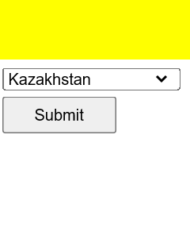
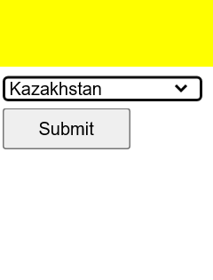

### false_success — click-button-sequence__s0
Objectif : `Click button ONE, then click button TWO.` — récompense 0.0, 3 pas

- t=0 `mouse_click(64.3, 184.0)` diff_écran=0.04353174603174603 
- t=1 `mouse_click(179.5, 184.0)` diff_écran=0.04353174603174603 
- t=2 `answer('-\nNo action required. The task was to click button ONE, then click button TWO, which has already been completed.')` diff_écran=None 

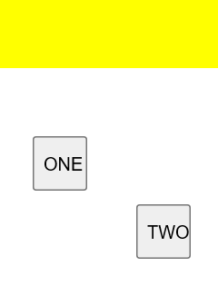

### wrong_final_action — click-button-sequence__s1
Objectif : `Click button ONE, then click button TWO.` — récompense 0.0, 2 pas

- t=0 `mouse_click(180.0, 141.8)` diff_écran=0.043611111111111114 
- t=1 `mouse_click(144.0, 189.0)` diff_écran=0.0 
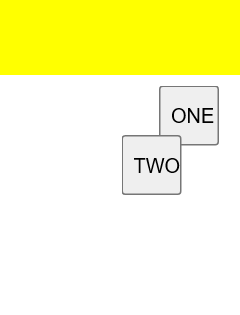
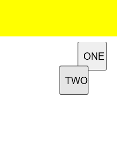

### loop — click-checkboxes-soft__s0
Objectif : `Select words similar to cut, scarlet, peaceful and click Submit.` — récompense 0.0, 12 pas

- t=0 `mouse_click(20.4, 91.3)` diff_écran=0.0044841269841269845 
- t=1 `mouse_click(20.4, 118.1)` diff_écran=0.007588183421516755 
- t=2 `mouse_click(20.4, 141.8)` diff_écran=0.007544091710758378 
- t=3 `mouse_click(20.4, 165.4)` diff_écran=0.002905643738977072 
- t=4 `mouse_click(20.4, 185.8)` diff_écran=0.004682539682539682 
- t=5 `mouse_click(20.4, 206.3)` diff_écran=0.007544091710758378 
- t=6 `mouse_click(20.4, 206.3)` diff_écran=0.004457671957671958 
- t=7 `mouse_click(20.4, 206.3)` diff_écran=0.004457671957671958 **[boucle]**
- t=8 `mouse_click(19.2, 204.8)` diff_écran=0.004457671957671958 **[boucle]**
- t=9 `mouse_click(19.2, 204.8)` diff_écran=0.004457671957671958 **[boucle]**
- t=10 `mouse_click(19.2, 204.8)` diff_écran=0.004457671957671958 **[boucle]**
- t=11 `mouse_click(19.2, 204.8)` diff_écran=0.004457671957671958 **[boucle]**
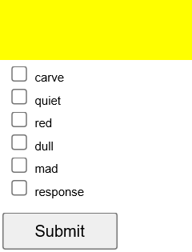
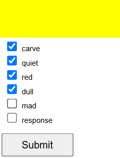

### false_success — click-checkboxes-soft__s1
Objectif : `Select words similar to mini, houses, water and click Submit.` — récompense 0.0, 6 pas

- t=0 `None` diff_écran=None 
- t=1 `mouse_click(24.0, 119.7)` diff_écran=0.004682539682539682 
- t=2 `mouse_click(24.0, 173.2)` diff_écran=0.007742504409171076 
- t=3 `mouse_click(24.0, 195.3)` diff_écran=0.007544091710758378 
- t=4 `mouse_click(120.0, 252.0)` diff_écran=0.002905643738977072 
- t=5 `mouse_click(120.0, 267.8)` diff_écran=0.08224867724867725 
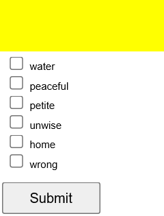
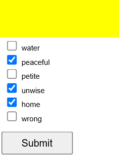

### wrong_final_action — click-dialog-2__s1
Objectif : `Click the button in the dialog box labeled "x".` — récompense 0.0, 1 pas

- t=0 `mouse_click(157.4, 246.0)` diff_écran=0.047407407407407405 
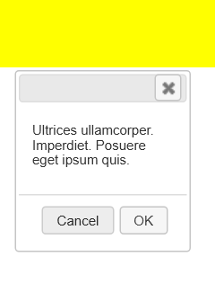

### grounding — click-menu__s0
Objectif : `Select Lesly>Lyssa` — récompense 0.0, 1 pas

- t=0 `mouse_click(36.0, 94.5)` diff_écran=0.08485449735449735 
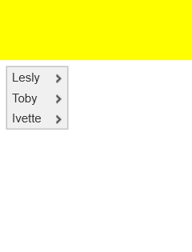

### abandon_or_budget — click-tab-2__s0
Objectif : `Switch between the tabs to find and click on the link "vel".` — récompense 0.0, 10 pas

- t=0 `mouse_click(36.0, 113.4)` diff_écran=0.0 
- t=1 `mouse_click(108.0, 113.4)` diff_écran=0.15573192239858907 
- t=2 `mouse_click(168.0, 113.4)` diff_écran=0.15488536155202823 
- t=3 `None` diff_écran=None 
- t=4 `None` diff_écran=None 
- t=5 `None` diff_écran=None 
- t=6 `mouse_click(144.0, 179.5)` diff_écran=0.0 
- t=7 `None` diff_écran=None 
- t=8 `None` diff_écran=None 
- t=9 `None` diff_écran=None 
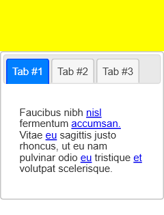
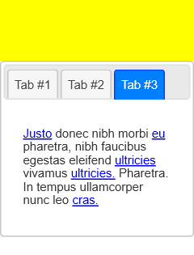

### grounding — click-tab-2__s1
Objectif : `Switch between the tabs to find and click on the link "faucibus".` — récompense 0.0, 10 pas

- t=0 `mouse_click(42.0, 31.5)` diff_écran=0.0 
- t=1 `mouse_click(108.0, 31.5)` diff_écran=0.0 
- t=2 `mouse_click(174.0, 31.5)` diff_écran=0.0 
- t=3 `mouse_click(42.0, 31.5)` diff_écran=0.0 
- t=4 `mouse_click(108.0, 31.5)` diff_écran=0.0 
- t=5 `mouse_click(174.0, 31.5)` diff_écran=0.0 
- t=6 `scroll_at(120, 31, 0, -150)` diff_écran=0.0 
- t=7 `keyboard_press("Tab")` diff_écran=0.011715167548500882 
- t=8 `scroll_at(120, 94, 0, 150)` diff_écran=0.02648148148148148 
- t=9 `scroll_at(120, 252, 0, -150)` diff_écran=0.02648148148148148 
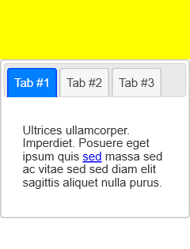
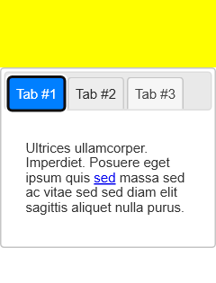

## Verdict STOP / GO

- NO-GO pour l'instant (boucle 20 % / 23 pos ; faux succès 40 % / 14 pos)