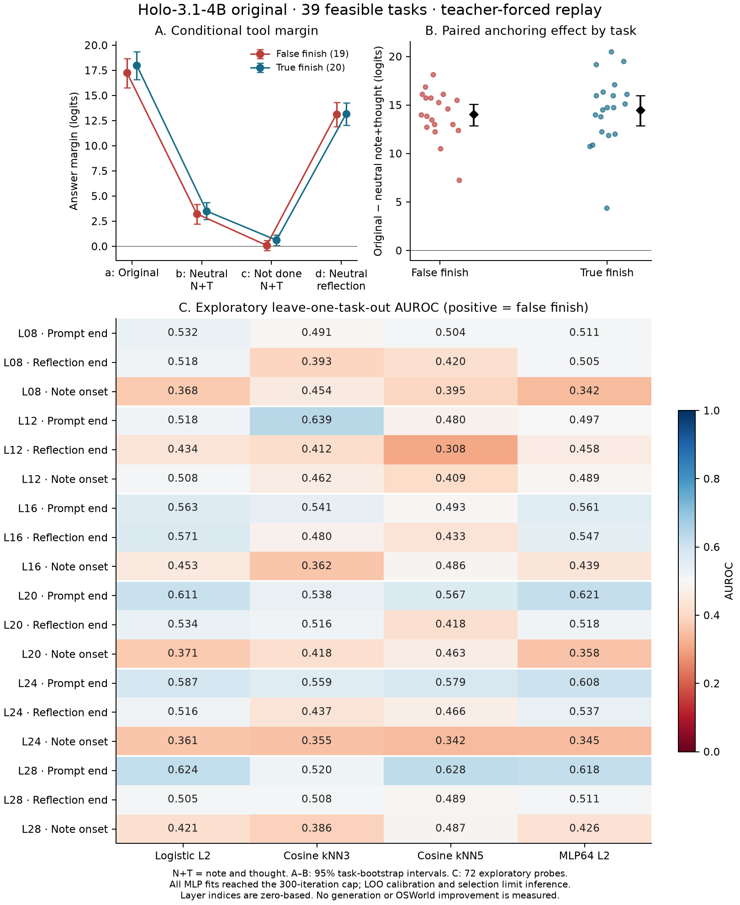

# Proof-anchor — ancrage et décodage sur 39 tâches faisables

Original Holo-3.1-4B, révision `8c88265a5a159bfd1492db9243733dd2e6e04a6e`. Résultats du 8 novembre 2026. Rejeu HF en teacher forcing, logits seulement, sans génération ni modification des poids.

**L’ablation conjointe de la note et de la pensée change la marge « answer » de 14.033 [12.875 ; 15.099] logits chez les faux « fini » et de 14.494 [12.875 ; 15.981] chez les vrais.** Cela mesure une dépendance causale au texte fourni avant le nom de l’outil. Cela ne démontre ni une copie littérale de la conclusion, ni l’absence de jugement interne. Après neutralisation b, answer reste favori parmi les outils dans 37/39 cas : une forte atténuation de marge ne signifie pas un changement de décision dans la même proportion.

**La meilleure des 72 sondes exploratoires atteint une AUROC de 0.639 [0.466 ; 0.803].** Son test de permutation donne p=0.0420 brut et p=1.0000 après correction conservatrice pour les 72 comparaisons. Le numéro du pas brut atteint 0.704 et la longueur du prompt 0.695 sur ces mêmes tâches. Ni la sélection du meilleur résultat ni les intervalles descriptifs ne permettent de conclure que l’information est absente.

## Cohorte, fidélité et bornes

- Manifeste astra-power : `2faee8f1af5a1243b8c8bacbf0369e4e035ab9dc336307c9f6678c0d134c24d0`.
- 19 faux « fini » (`fs+`, score officiel 0), 20 vrais (`fs-`, score 1), une observation par tâche. Les 39 fonctions d’évaluation et leurs hashes ont été vérifiés : aucune tâche officiellement infaisable. Les 16 états sains du manifeste ne font pas partie des deux analyses demandées. Cette cohorte sélectionnée n’est pas un échantillon aléatoire des tâches OSWorld; les intervalles ne corrigent pas son biais de sélection.
- Les 39 prompts sont les messages figés d’astra-power, construits par `osw_replay`. Hashes des trajectoires et des payloads, historique textuel, schémas et égalité pixel des images retenues vérifiés. Le processor HF exact est celui de la révision demandée. Les deux shards ont été hashés indépendamment : `MODEL_AUDIT.md`.
- 156/156 forwards distincts achevés, 156 commencés, BF16, `use_cache=False`, `logits_to_keep=1`. Pic alloué CUDA : 11.99 Go. GPU via `gpu_slot.sh`; caches sous `/workspace/astra/proof-anchor/compile_cache`.
- Les longueurs totales en tokens, le prompt multimodal et la frontière avant le premier token du nom d’outil sont identiques entre conditions. Les textes effectivement utilisés, positions et hashes sont dans `PREFLIGHT.json`.
- `power_032` a une note JSON `null` : celle-ci reste `null`; les conditions b/c modifient sa pensée seule. Ce cas reste inclus, et une analyse de sensibilité à 38 tâches est donnée ci-dessous.
- Deux erreurs de préparation ont été conservées dans les journaux : frontière de tokenisation lors du préflight CPU, puis comparaison tuple/liste après sérialisation JSON. La première tentative GPU s’est arrêtée avant tout forward. Aucun résultat n’a été supprimé ou remplacé.

## 1. Ancrage à l’échelle

La marge vaut `logit(answer) − max(logit(autres outils))`. Pour un outil dont le nom contient plusieurs tokens, on compare son **premier token**, conformément au code d’ancrage réutilisé. Il ne s’agit ni d’une probabilité de terminer, ni de la vraisemblance du nom complet.

| Condition | Faux fini, n=19 : marge [IC95] | Vrai fini, n=20 : marge [IC95] |
|---|---:|---:|
| a — réflexion, note et pensée originales | 17.263 [15.763 ; 18.664] | 18.000 [16.587 ; 19.356] |
| b — note et pensée neutres | 3.230 [2.243 ; 4.158] | 3.506 [2.694 ; 4.356] |
| c — note et pensée contrefactuelles | 0.099 [-0.414 ; 0.579] | 0.613 [0.094 ; 1.125] |
| d — réflexion neutre, note et pensée originales | 13.155 [11.891 ; 14.299] | 13.184 [12.047 ; 14.262] |

Les phrases neutres répètent « Observing the current screen. »; les contrefactuels répètent « The task is not complete yet; I still need to inspect the screen. ». Une terminaison tronquée ou une ponctuation finale ajuste exactement la longueur. La réflexion enregistrée est identique en a/b/c; seule d la neutralise.

| Contraste apparié, positif = texte supprimé favorable à answer | Faux fini [IC95] | Vrai fini [IC95] |
|---|---:|---:|
| a − b | 14.033 [12.875 ; 15.099] | 14.494 [12.875 ; 15.981] |
| a − c | 17.164 [15.678 ; 18.553] | 17.387 [15.806 ; 18.897] |
| a − d | 4.109 [3.543 ; 4.681] | 4.816 [4.112 ; 5.603] |

IC par bootstrap de tâches stratifié, 10 000 réplications, même tirage pour les conditions d’une tâche. Une tâche correspond ici à un contexte.

| Ratio demandé | Faux fini [IC95] | Vrai fini [IC95] |
|---|---:|---:|
| Moyenne de (a−b)/a par tâche | 0.821 [0.776 ; 0.874] | 0.800 [0.738 ; 0.851] |
| (moyenne a − moyenne b) / moyenne a | 0.813 [0.771 ; 0.864] | 0.805 [0.754 ; 0.849] |

**Le ratio porte sur la note et la pensée ensemble.** Il peut dépasser 1 ou être négatif; ce n’est pas une part de variance, une part de probabilité, ni une décomposition causale additive. Dénominateurs initiaux nuls : 0 faux et 0 vrais. Dénominateurs initiaux de valeur absolue <1 : 0 et 0.

Interaction entre strates : `(a−b) faux − (a−b) vrais` = -0.461 [-2.362 ; 1.499] logits; p bilatéral par 10 000 permutations de labels de tâches = 0.6450. **Ce test porte sur une différence, pas sur une équivalence.** Une interaction compatible avec zéro serait cohérente avec une influence commune de la conclusion écrite, sans prouver l’absence de discriminateur.

Sensibilité sans la note null : a−b = 14.033 [12.868 ; 15.092] chez les faux (n=19) et 15.026 [13.829 ; 16.276] chez les vrais (n=19).

| Condition | Marges answer positives, faux | Marges answer positives, vrais |
|---|---:|---:|
| a | 19/19 | 20/20 |
| b | 18/19 | 19/20 |
| c | 10/19 | 13/20 |
| d | 19/19 | 20/20 |

L’ablation remplace toute la note et toute la pensée : elle ne sépare pas le rôle de la conclusion de celui des détails descriptifs qu’elles contiennent. Les contrefactuels et les répétitions sont des entrées artificielles. Leur effet conditionnel sur les logits ne mesure pas la réaction du modèle en génération libre, sa capacité à réparer une tâche, ni un gain OSWorld.

## 2. Information décodable dans les résiduels

Sorties résiduelles après les blocs de decoder **indices zéro-based** 8, 12, 16, 20, 24 et 28 (9e, 13e, 17e, 21e, 25e et 29e blocs). Positions : dernier token du prompt; dernier token de réflexion avec son délimiteur de fermeture; dernier token avant le contenu de note (avant `null` pour le cas correspondant). Aucun contenu de la note courante n’est accessible à la position début de note.

Validation leave-one-task-out : 39 folds, label positif = faux fini. Hyperparamètres fixes : logistique L2 C=0,1; kNN cosinus k=3 ou 5, vote uniforme; MLP ReLU 64 unités, alpha L2=10, optimiseur L-BFGS, 300 itérations maximum, seed 1729. Centrage-réduction appris uniquement sur les 38 tâches d’entraînement pour logistique/MLP; kNN sur les résiduels bruts. Une SVD du seul entraînement conserve tout son sous-espace non nul (seuil numérique relatif 1e−10), sans sélection supervisée de dimensions. Les directions du test orthogonales à cet espace sont écartées. Le MLP est initialisé dans cette base. Les 72 modèles sont exploratoires.

### Baselines sur le même découpage

| Baseline | AUROC [intervalle descriptif 95 %] |
|---|---:|
| step | 0.518 [0.332 ; 0.705] |
| step_raw_increasing | 0.704 [0.530 ; 0.854] |
| prompt_length | 0.518 [0.329 ; 0.705] |
| prompt_length_raw_increasing | 0.695 [0.518 ; 0.850] |
| reasoning_length | 0.432 [0.242 ; 0.629] |
| reasoning_length_raw_increasing | 0.587 [0.384 ; 0.771] |
| step_prompt_reasoning | 0.555 [0.366 ; 0.742] |
| train_prevalence_only | 0.000 [0.000 ; 0.000] |

**Piège du leave-one-out :** un prédicteur constant égal à la prévalence d’entraînement donne 18/38 à chaque faux fini tenu à l’écart et 19/38 à chaque vrai, donc AUROC=0 sans aucun signal. Une sonde régularisée peut subir ce biais de calibration. Les permutations avec réajustement le reproduisent; une AUROC faible n’est pas une preuve d’absence d’information, et aucun score n’a été inversé après résultat.

### Toutes les sondes

| Couche (index) | Position | Logistique L2 | kNN3 | kNN5 | MLP64 |
|---:|---|---:|---:|---:|---:|
| 8 | prompt_end | 0.532 [0.342 ; 0.721] | 0.491 [0.322 ; 0.655] | 0.504 [0.332 ; 0.679] | 0.511 [0.324 ; 0.697] |
| 8 | reflection_end | 0.518 [0.334 ; 0.708] | 0.393 [0.228 ; 0.563] | 0.420 [0.249 ; 0.596] | 0.505 [0.324 ; 0.692] |
| 8 | note_onset | 0.368 [0.197 ; 0.550] | 0.454 [0.289 ; 0.618] | 0.395 [0.246 ; 0.546] | 0.342 [0.179 ; 0.518] |
| 12 | prompt_end | 0.518 [0.329 ; 0.703] | 0.639 [0.466 ; 0.803] | 0.480 [0.309 ; 0.650] | 0.497 [0.303 ; 0.684] |
| 12 | reflection_end | 0.434 [0.247 ; 0.616] | 0.412 [0.253 ; 0.580] | 0.308 [0.179 ; 0.450] | 0.458 [0.271 ; 0.642] |
| 12 | note_onset | 0.508 [0.316 ; 0.695] | 0.462 [0.295 ; 0.637] | 0.409 [0.250 ; 0.579] | 0.489 [0.300 ; 0.676] |
| 16 | prompt_end | 0.563 [0.382 ; 0.747] | 0.541 [0.378 ; 0.700] | 0.493 [0.320 ; 0.668] | 0.561 [0.379 ; 0.742] |
| 16 | reflection_end | 0.571 [0.382 ; 0.742] | 0.480 [0.314 ; 0.647] | 0.433 [0.268 ; 0.600] | 0.547 [0.358 ; 0.721] |
| 16 | note_onset | 0.453 [0.268 ; 0.639] | 0.362 [0.217 ; 0.520] | 0.486 [0.314 ; 0.661] | 0.439 [0.258 ; 0.626] |
| 20 | prompt_end | 0.611 [0.429 ; 0.795] | 0.538 [0.375 ; 0.712] | 0.567 [0.395 ; 0.743] | 0.621 [0.442 ; 0.805] |
| 20 | reflection_end | 0.534 [0.347 ; 0.713] | 0.516 [0.343 ; 0.689] | 0.418 [0.258 ; 0.587] | 0.518 [0.332 ; 0.697] |
| 20 | note_onset | 0.371 [0.203 ; 0.561] | 0.418 [0.254 ; 0.592] | 0.463 [0.305 ; 0.632] | 0.358 [0.192 ; 0.547] |
| 24 | prompt_end | 0.587 [0.403 ; 0.771] | 0.559 [0.382 ; 0.737] | 0.579 [0.407 ; 0.753] | 0.608 [0.421 ; 0.787] |
| 24 | reflection_end | 0.516 [0.326 ; 0.700] | 0.437 [0.268 ; 0.613] | 0.466 [0.289 ; 0.643] | 0.537 [0.353 ; 0.718] |
| 24 | note_onset | 0.361 [0.182 ; 0.561] | 0.355 [0.205 ; 0.521] | 0.342 [0.193 ; 0.507] | 0.345 [0.168 ; 0.542] |
| 28 | prompt_end | 0.624 [0.439 ; 0.803] | 0.520 [0.345 ; 0.693] | 0.628 [0.457 ; 0.789] | 0.618 [0.437 ; 0.797] |
| 28 | reflection_end | 0.505 [0.324 ; 0.687] | 0.508 [0.332 ; 0.680] | 0.489 [0.309 ; 0.663] | 0.511 [0.326 ; 0.695] |
| 28 | note_onset | 0.421 [0.242 ; 0.613] | 0.386 [0.225 ; 0.553] | 0.487 [0.317 ; 0.655] | 0.426 [0.247 ; 0.616] |

Chaque cellule donne AUROC [intervalle descriptif 95 %]. Les intervalles rééchantillonnent les scores OOF déjà ajustés, par tâches et par classe (10 000 tirages). Ils ne refont ni l’apprentissage ni la sélection du gagnant et ne garantissent pas une couverture de 95 % pour la performance future; les folds ont des entraînements largement communs.

Meilleure sonde observée : `L12_prompt_end_knn3_cosine`, 0.639 [0.466 ; 0.803]. Avertissements de convergence : 702 sur 2 808 ajustements initiaux. **Les 702 fits MLP ont atteint le plafond préspécifié de 300 itérations.** Leurs résultats sont donc limités par l’optimisation et ne peuvent pas exclure une information non linéaire.

| Meilleure sonde moins baseline | Δ AUROC [intervalle descriptif 95 %] |
|---|---:|
| step | 0.121 [-0.116 ; 0.361] |
| prompt_length | 0.121 [-0.111 ; 0.358] |
| reasoning_length | 0.208 [-0.080 ; 0.493] |
| step_prompt_reasoning | 0.084 [-0.164 ; 0.337] |
| step_raw_increasing | -0.064 [-0.286 ; 0.167] |
| prompt_length_raw_increasing | -0.055 [-0.274 ; 0.171] |
| reasoning_length_raw_increasing | 0.053 [-0.224 ; 0.339] |

### Vérification supplémentaire de l’optimisation du MLP

Après observation des 702 avertissements initiaux, une passe supplémentaire a été déclarée dans `MLP_OPTIMIZATION_AMENDMENT.md` : mêmes 18 configurations, données, seed, architecture et régularisation; seul le plafond d’itérations passe de 300 à 3 000. Les résultats primaires restent inchangés dans `RESULT_CORE.json`. Cette analyse supplémentaire ne réutilise pas le p du gagnant primaire.

702 fits supplémentaires achevés en 396.7 s; 232 conservent un avertissement de convergence. Un arrêt sans avertissement peut dépendre de la variation de l’objectif, sans garantir un petit gradient (voir le pilote indépendant). La capacité du MLP reste imparfaitement évaluée.

Maximum descriptif supplémentaire : `L28_prompt_end_mlp64_l2`, AUROC 0.621 [0.439 ; 0.800]. Aucun test de permutation n’est réalisé pour cette famille supplémentaire; elle ne doit pas être fusionnée aux 72 configurations initiales tout en conservant leur correction.

| Couche | Position | MLP à 300 itérations | MLP à 3 000 [intervalle descriptif 95 %] | Folds avec avertissement /39 |
|---:|---|---:|---:|---:|
| 8 | prompt_end | 0.511 | 0.532 [0.342 ; 0.721] | 12 |
| 8 | reflection_end | 0.505 | 0.511 [0.326 ; 0.700] | 26 |
| 8 | note_onset | 0.342 | 0.358 [0.187 ; 0.539] | 24 |
| 12 | prompt_end | 0.497 | 0.511 [0.318 ; 0.695] | 20 |
| 12 | reflection_end | 0.458 | 0.437 [0.250 ; 0.621] | 27 |
| 12 | note_onset | 0.489 | 0.505 [0.316 ; 0.692] | 10 |
| 16 | prompt_end | 0.561 | 0.566 [0.382 ; 0.750] | 8 |
| 16 | reflection_end | 0.547 | 0.574 [0.384 ; 0.745] | 4 |
| 16 | note_onset | 0.439 | 0.445 [0.263 ; 0.632] | 18 |
| 20 | prompt_end | 0.621 | 0.608 [0.426 ; 0.790] | 16 |
| 20 | reflection_end | 0.518 | 0.529 [0.342 ; 0.708] | 10 |
| 20 | note_onset | 0.358 | 0.358 [0.189 ; 0.547] | 21 |
| 24 | prompt_end | 0.608 | 0.589 [0.403 ; 0.774] | 11 |
| 24 | reflection_end | 0.537 | 0.503 [0.316 ; 0.687] | 9 |
| 24 | note_onset | 0.345 | 0.361 [0.179 ; 0.561] | 11 |
| 28 | prompt_end | 0.618 | 0.621 [0.439 ; 0.800] | 0 |
| 28 | reflection_end | 0.511 | 0.500 [0.318 ; 0.682] | 4 |
| 28 | note_onset | 0.426 | 0.432 [0.250 ; 0.624] | 1 |

Les écarts avec les baselines utilisent les mêmes tirages bootstrap. Ils restent exploratoires et favorisés par la sélection du meilleur parmi 72. Les comparaisons à quelques métadonnées n’éliminent pas les autres facteurs de confusion : applications, instructions, contenu des écrans ou trajectoires. La cohorte contient notamment des applications présentes seulement parmi les vrais finis.

### Permutations et puissance

1 000 permutations des labels entre tâches, 19 positifs et 20 négatifs conservés, avec réajustement des 39 folds de la configuration gagnante. Comparaison exacte de la statistique entière `2U` pour inclure les égalités. AUROC nulle moyenne : 0.469, quantiles 2,5–97,5 % : [0.291 ; 0.665]. p unilatéral brut = 0.0420; Bonferroni 72 = 1.0000.

**Avec 1 000 permutations, le plus petit p corrigé possible vaut 72/1001 = 0,07193.** Le test familial à 5 % a donc une puissance nulle quelle que soit la qualité du score. Le p brut du gagnant n’est pas confirmatoire; sa distribution permutée est celle de cette configuration, pas celle du maximum de 72 sondes.

Pour quantifier la faiblesse de n=39 séparément de cette résolution, une simulation de scores continus binormaux indépendants utilise 19 positifs et 20 négatifs, 20 000 réplications par AUROC, écart de moyenne `sqrt(2) × Phi^-1(AUROC)`, seuil de rejet exact de Mann–Whitney. Les 380 comparaisons de paires ne sont pas traitées comme indépendantes.

| Test théorique d’un score oracle fixé à l’avance | AUROC minimale pour 80 % de puissance |
|---|---:|
| Unilatéral α=0,05 | 0.725 |
| Bilatéral α=0,05 | 0.755 |
| Unilatéral α=0,05/72, résolution idéale | 0.845 |

Grille AUROC : 0,005; erreur Monte-Carlo à 80 % ≈ 0.0028 en probabilité. Ces seuils sont **optimistes** pour une sonde apprise sur 38 tâches : ils supposent un score oracle déjà connu. Ils ne démontrent pas que les sondes employées avaient cette sensibilité.

## Conclusion utilisable dans le papier

> Sur 39 contextes de tâches faisables, les substitutions de la note et de la pensée quantifient l’influence du texte précédant le choix d’outil sur la marge conditionnelle de terminaison. Les sondes linéaires et non linéaires, leurs baselines et leurs limites de puissance sont rapportées sur les mêmes tâches. Ces expériences ne permettent pas de transformer une absence de preuve de décodage en preuve d’absence d’information dans le modèle.

## Vérification et fichiers

Les vérifications indépendantes sont consignées dans `MODEL_AUDIT.md`, `VERIFY_REPLAY.md`, `VERIFY_CAPTURE_FINAL.md`, `VERIFY_METHODS.md` et `VERIFY_FINAL.md`. Le verdict final fait autorité sur le statut de vérification; le présent texte ne remplace pas ces contrôles.

- Résultats complets : `RESULT.json`; scores individuels OOF : `oof_scores.npz`.
- 156 mesures : `forwards.jsonl`; captures : `captures/power_*.npz`; permutations : `permutations.jsonl`.
- Protocole : `PROTOCOL.md`; sources : `SOURCE_AUDIT.json`, `manifest.json`; préflight : `PREFLIGHT.json`.
- Reproduction : `run_capture.py` (GPU), `analyze.py` (CPU), `render_report.py`.
- Source canonique : `/workspace/astra/proof-anchor/`; copie orbit : `experiments/proof_anchor/`.

Aucun résultat de génération, de réparation ou de gain OSWorld n’est revendiqué.
