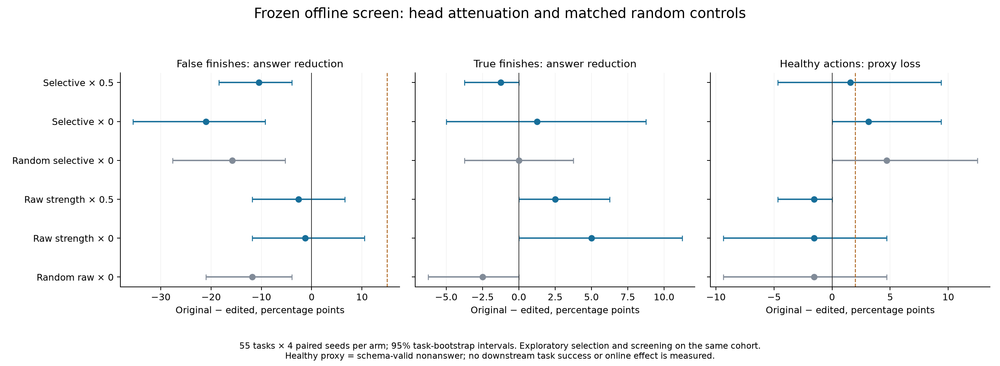
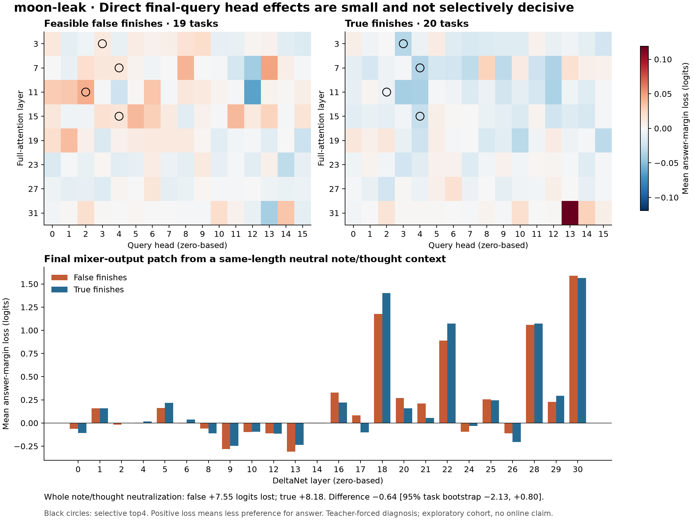

# moon-leak — note/thought → tool-choice channel

**NO-GO, decision recorded 08:20UTC, before the 09:45 deadline.** All four targeted edits and both matched random controls fail the false-finish reduction and selectivity gates. No online launch is requested. All 1320 new GUI outputs are valid JSON, with zero errors or truncations; structural validity does not establish task success.

The lowest observed fs+ answer count among targeted edits is 56/76 for raw-strength4 × 0, versus 55/76 for original A. True-finish answers simultaneously fall from 75/80 to 71/80. There is no observed false-finish reduction to trade against that loss. The tested global head attenuations do not deliver the requested selective channel cut.

| Arm | fs+ answer /76 | True answer /80 | Healthy valid nonanswer /64 | Selective reduction vs A, pp [95% CI] |
|---|---:|---:|---:|---:|
| Original A |55|75|59|reference|
|Selective4 × 0.5|63|76|58|-9.28 [-17.17, -1.51]|
|Selective4 × 0|71|74|57|-22.30 [-38.09, -8.03]|
|Raw strength4 × 0.5|57|73|60|-5.13 [-15.59, +5.26]|
|Raw strength4 × 0|56|71|60|-6.32 [-18.16, +6.71]|
|Random, selective layers × 0|67|75|56|-15.79 [-27.63, -5.20]|
|Random, raw layers × 0|64|77|60|-9.34 [-18.55, -0.33]|

Selective reduction = (A − edit) fs+ answer rate minus (A − edit) true-finish answer rate; positive is desired. Intervals are exploratory paired task bootstraps, not held-out confirmation. Selective zero and its random control also fail the healthy-loss≤2pp gate. No qualitative improved-action claim or online outcome is made.

The independent data, weight and numerical audits pass. A separate process reservation remains: the retrospective budget audit flags continuation after two failed fidelity attempts without execution progress. This is disclosed below; full process compliance is not claimed.

## Question and scope
Can a weights-only reduction of attention heads that read the model's own note/thought reduce false completion more than genuine completion? The source model is Hcompany/Holo-3.1-4B, exact revision 8c88265a5a159bfd1492db9243733dd2e6e04a6e. No gradient, LoRA, runtime hook, changed prompt, or changed harness is part of any candidate; hooks are used only for diagnosis.

The inspiration [Who Verifies the Agent's Success Claim?](https://arxiv.org/abs/2610.29609) tests self-report leakage in downstream completion judges. Moving that idea into the agent's own tool-choice circuit is an unproven extension. Broad's donor-JSON swap changed answer margins by −15.75/−21.5 logits on2 false-finish contexts, but had no matched true-finish intervention and changed prefix lengths by+15/−25 tokens. It motivates the test; it does not establish selective circuitry.

## Frozen data and baseline
The astra-power cohort manifest SHA256 is 2faee8f1af5a1243b8c8bacbf0369e4e035ab9dc336307c9f6678c0d134c24d0. Its55 task-disjoint contexts comprise 19 feasible false finishes (score0),20 true finishes (score1),16 healthy actions. All have strict evaluator feasibility. Heads are selected on this cohort, so its screening is exploratory, not independent validation. Neither the 45 reserve nor split_test has been opened by moon-leak.

Frozen messages come directly from power payloads with SHA checks. Recorded suffixes were extracted from 39 local trajectories after each whole traj hash matched the frozen source_hashes. The extracted bundle SHA256 is 93b32dbd65a93a671b423464fa788783b2f0f9d3c440b00c68a7d7126d430d57. Independent review verified exact step equality for all 39 rows. No screenshots were regenerated.

Original A is the completed astra-power run, exact55 × 4 paired rows/seeds 17000–17003, ended07:11:06UTC, vLLM0.23.0. It has220/220 valid JSON and zero errors/truncations.

| Stratum | A metric | Count | Rate |
|---|---|---:|---:|
| Feasible false finish | answer |55/76|72.37%|
| True finish | answer |75/80|93.75%|
| Healthy action | valid nonanswer |59/64|92.19%|

## Attribution design and validity
For every head in full-attention layers 3,7,11,15,19,23,27,31 (zero-based;16 heads each), ablate the final query's links to tokens overlapping JSON note/thought values and renormalize attention over other keys. The task, screens, external reasoning, and other heads remain fixed. Measure answer minus maximum other legal-tool first-token logit. This teacher-forced margin is a diagnostic, never the admission outcome.

Cache copies isolate all mutable KV, DeltaNet recurrent and convolution states. Pilot verified exact repeated hidden states and tool-logit vectors. Numerical confounds found before selection were fixed: correct cached multimodal positions, deterministic explicit final-token attention for all 8 attention layers, and matched zero-mask controls. Prefill remains SDPA. Legal-tool logits are FP32 projections of BF16 final hidden states and existing BF16 lm_head rows; they differ from BF16-rounded broad logs. Full-versus-cache margin error is recorded per context; all must stay≤0.75. All zero-mask controls must be exact zero. Model parameter versions must remain unchanged.

Each of 24 DeltaNet layers is also patched at its final mixer output with the corresponding output from the same-length context whose strictly interior JSON note/thought value tokens are replaced by spaces. Boundary-crossing tokens remain; neutralization is not complete lexical erasure. This removes both note and thought, while preserving external reasoning and positions. Layer-output replacement tests a carrier of the counterfactual change, not a clean attribution to that layer's recurrent mechanism.

Engineering failures and pilots are preserved but excluded from ranking. Five contexts completed before one missing original_pod_path stopped the first full process; the canonical recorded-step bundle fixes provenance for all 39, and resumption skips only complete contexts. Full attribution budget 6435 forward calls, hard process total 6500; inclusive fidelity-debugging cap 8500. All runs use fleet slots and 2 CPU threads.

Independent retrospective accounting reconstructs7426 attempted forwards including failed pilots, below8500. Two170-call attempts were missing from the protocol's earlier illustrative sum, now corrected in an appended reconciliation. Their exact counts and the first failed 3-call attempt are inferred from logged control flow; the other totals are explicit. There is also a process reservation: two attempts failed at the same equality gate without execution progress before the deterministic repair passed. The conservative reading of the two-round stop rule therefore flags a deviation; added diagnostic information does not establish improved execution. The retrospective check records this rather than claiming full process compliance. See VERIFY_BUDGET.md. No further attribution calls are planned.

## Candidate and screening protocol
Two families of 4 heads are frozen. Selective rank (mean false-finish margin drop minus mean true-finish drop): L11h2, L7h4, L3h3, L15h4. Literal raw-channel rank (largest mean false-finish margin drop): L7h13, L11h2, L7h8, L15h5. For both, scale o_proj columns256h:256(h+1) by0.5 or0. The raw family replaces the original optional2/6-head sweep following independent review, before any candidate generations were inspected; the candidate cap decreases from 6 to 4. The original unused2/6 specs are retained for audit. The selection rule and its amendment are exploratory. Random controls match each family's head counts per layer, seed261029609; use the best numerically passing dose, or zero if neither passes, at most one control dose per family. No further search after these4 candidates.

A head-column edit suppresses all uses of that head at every position; it cannot selectively remove only note/thought edges. Therefore causal diagnosis does not imply a selective weight edit. Wv/Wk variants are optional and not in the primary sweep; GQA shares each KV head across4 query heads, and normalization complicates K scaling.

Every tested checkpoint gets a full independent CPU tensor audit before serving: exact declared formula, all other columns/tensors bitwise identical, identical tokenizer/config/index metadata, complete HF shards. GPU serving is only own port8030, vLLM0.23.0, memory fraction0.15, KV6GiB, maxlen32768, maxseq32, qwen3 reasoning parser. Original power A used the same vLLM/model/schema but resource caps0.20/KV8GiB; this resource-setting difference is disclosed rather than described as identical serving configuration.

Per arm:220 GUI draws, T0.8/top_p0.9/top_k20/max3072, reasoning enabled/medium, exact JSON schema and seeds; plus 3 fixed plain-text T0 controls. No retries. Gates: JSON≥95%, healthy proxy loss≤2pp, healthy text, fs+ answer reduction≥15pp or independently verified better actions; channel hypothesis additionally requires fs+ loss greater than true-finish loss. Healthy proxy means valid nonanswer, not demonstrated downstream task success. Paired bootstrap intervals resample tasks, not individual seeds. No online admission from incomplete arms.

## Results and decision
Attribution is complete:6357 raw records,6435 forward calls, all 39 contexts complete, all 312 zero-mask controls exactly zero, maximum full-versus-cache margin difference0.198738. Independent recomputation matches every supplied aggregate exactly.

| Diagnostic | Mean fs+ margin loss | Mean true-finish margin loss | Difference fs+−true |
|---|---:|---:|---:|
| All note/thought interior tokens neutralized |7.5485|8.1850|−0.6365|
| Best selective single head, L11h2 |0.04359|−0.00739|+0.05098|
| Best raw-strength single head, L7h13 |0.04798|0.01811|+0.02986|
| Best selective DeltaNet output patch, L17 |0.08205|−0.10039|+0.18243|

Neutralization difference task-bootstrap95% interval is[−2.1332, +0.7996] logits. This does not establish equivalence or absence of an internal discriminator. Selection-biased descriptive intervals for selected heads are in independent_attribution_stats.json, not treated as confirmatory significance. The very small head effects should be interpreted alongside the measured replay sensitivity. Narrow final-query attention-link masking cannot rule out earlier-token, multi-head, recurrent-state, or residual routes.

All six generation arms are complete. Independent reconstruction from raw JSON confirms every schema flag, tool label, frozen payload hash, task/seed key and server receipt. Each complete checkpoint passed a 724-tensor byte audit before serving: only declared o_proj head columns changed; all other tensors/artifacts remained identical. All six failed checkpoints were retired after their owned servers stopped. Specs, receipts and outputs remain available for exact reconstruction.

The random controls use L3h5, L7h11, L11h6, L15h0 for the selective family and L7h11, L7h5, L11h11, L15h6 for the raw family. Both use zero dose because neither targeted dose passed the numerical gates, following the rule fixed before generation inspection. They match each family's exact head count per layer. The half-dose edits have no separately measured half-dose random control.

Direct paired control contrasts subtract edited rates from random-control rates. For selective4 × 0, the fs+ contrast is−5.26pp [−15.79, +2.63] and differential selectivity is−6.51pp [−18.42, +3.88]. For raw4 × 0, the fs+ contrast is+10.53pp [−3.95, +25.00], but true-finish contrast is also+7.50pp [+1.25, +15.00], leaving differential selectivity+3.03pp [−12.63, +18.75]. Neither interval resolves a targeted selectivity advantage. A relative advantage over an impaired random control would not itself establish improvement over A.

The three T0 prompts were reviewed for A and all six arms. Arithmetic323 and practical three-step Linux renaming are correct throughout. The translation is incorrect throughout: A and four arms say “opened”; raw4_s0 and random4_s0 say “processed”. Those latter two arms are not a matched pair. Within the actual pairs, head4_s0/opened versus random4_s0/processed and raw4_s0/processed versus random_raw4_s0/opened differ only in incorrect wording. No new repetition, truncation, reasoning leak or incoherence appears. The translation correctness check fails for every model; no general text-health PASS is claimed from these three prompts.

Total new inference requests:1320 GUI plus 21 text (18 arm controls and 3 original controls), with 220 original GUI rows reused. No request was retried. Attribution accounting is separate:7426 attempted forwards including fidelity debugging,6435 in the completed main attribution. The forward total is partly reconstructed as detailed in VERIFY_BUDGET.md. No reserve45 or split_test data was used to construct or screen this experiment.

This negative result is narrow. The final-query attention-link ablations do not cover distributed earlier-position computation, and multiplying a head's global o_proj columns alters every use of that head. The failure therefore rejects these concrete weight edits, not all possible internal verification mechanisms or all forms of note dependence. Wv/Wk and DeltaNet weight edits were not tested. No further variants are scheduled.

## Evidence
PROTOCOL.md; VERIFY_FINAL.md; VERIFY_ATTRIBUTION.md; VERIFY_ATTRIBUTION_RESULTS.md; VERIFY_BUDGET.md; VERIFY_TEXT_CONTROLS.md; VERIFY_CONTROL_CONTRASTS.md; attribution_pilot_attempt*.log/jsonl; attribution.jsonl; baseline_A/; spec_*.json; build_*.json; verify_*.json; runs/; screen_*.json. Decisions and any cleanup are appended in LOG.md. Ares owns all online confirmation.

The owned frozen/ snapshot contains 58 byte-verified files, including all 55 compressed inputs. See REPRODUCE.md for CPU audits and reconstruction limits. The shared repository was initially dirty and git pull --rebase was blocked; no unrelated files were stashed, restored or staged. Results are archived under experiments/weight_edits/head_attenuation; no mixed shared-checkout commit was made.
