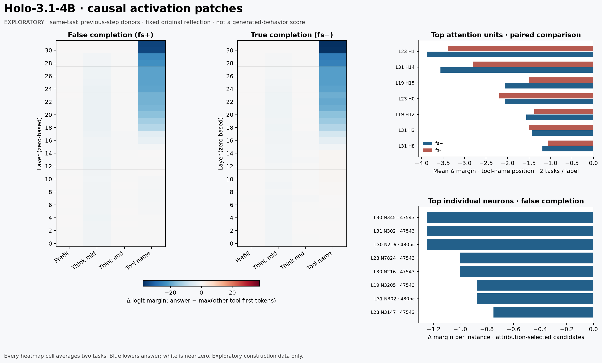
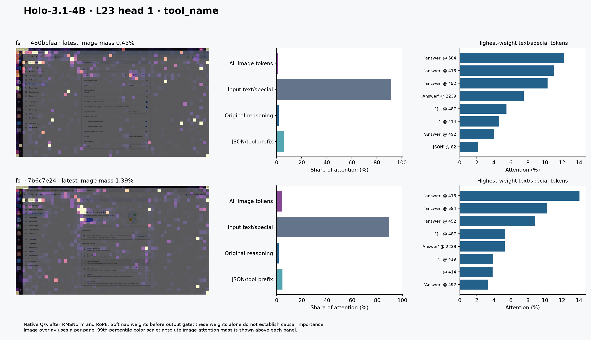

# astra-circuit — cartographie causale de `answer` dans Holo-3.1-4B

Mise à jour UTC : 2026-11-07T20:46:21+00:00.
État : mesures des trois bras génératifs terminées ; voir verdict et audit final.

**Conclusion établie par la cartographie.** Le transfert résiduel tardif change le choix prédit par le probe conditionné sur les faux et les vrais « fini », après réflexion originale forcée. Les composants isolés ressemblent à un circuit de récupération du nom d’outil et de construction du JSON ; aucune spécificité au faux succès n’est établie. Les trois têtes et dix neurones retenus réduisent fortement la marge, sans suffire à changer le choix sur les quatre paires. Aucun gain OSWorld n’est démontré et aucun candidat n’est admis.

**Validation générative terminée.** Original :8/8 answer sur fs+ ; c1_a05: 8/8 answer sur fs+ ; c1_a10: 8/8 answer sur fs+ ; c1_random_a05: 8/8 answer sur fs+. Tous ces contextes ont servi à la construction. Le contrôle aléatoire a été mené jusqu’au bout.
Les deux intensités C1 échouent au gate exploratoire figé. La règle d’arrêt préétablie est atteinte : les expériences s’arrêtent au terme du contrôle aléatoire, sans édition de poids ni évaluation de confirmation.

**Périmètre et provenance.** Uniquement le split de diagnostic. Six contextes cibles issus de cinq tâches Chrome, dont deux fs+, deux fs− et deux pas sains ; quatre donneurs au pas immédiatement précédent de la même tâche. Ce sont des données de construction. Le manifeste et les 24 générations originales de la session précédente ont été conservés ; SHA256 du manifeste : `814615607011d4919faa380198390be42c8e49045383f3a234f6b9b5a6769c43`. Les empreintes des autres artefacts sont dans `environment_fingerprint.json`. Les quatre donneurs régénérés à seed4000 appellent tous `click`, valablement, sans troncature. Les autres outils et données partagés ont été utilisés en lecture seule. Aucun fichier du split test ni résultat test n’a été lu.

La réserve canonique de 45 tâches est figée dans `confirm_tasks_frozen.json`, SHA256 fichier `a47533d90a7d4e59bb81bd191529c41adf9af2d3676100539bd4d603c14b67cb`. Intersection de cette réserve reçue avec nos cinq tâches de construction : zéro. Son métadocument autorise toutefois astra-stuck à construire sur une partie de ces tâches : cette copie seule ne certifie donc pas une réserve vierge pour toute la flotte. La provenance des expositions doit être revalidée avant toute confirmation commune. Les 335 anciennes lignes « confirmation » du manifeste ne sont pas cette réserve et ne sont pas utilisées pour revendiquer une tenue à part. Aucune évaluation de confirmation n’est revendiquée ici.

| Cible (identifiant court) | Classe | Pas cible ← source |
| --- | --- | --- |
| 0d8b7de3 | fs- | 3 ← 2 |
| 47543840 | fs+ | 13 ← 12 |
| 480bcfea | fs+ | 4 ← 3 |
| 7b6c7e24 | fs- | 3 ← 2 |

**Mesure et fidélité.** Réflexion originale générée, puis teacher-forcing du préfixe jusqu’au nom d’outil. Le probe est le logit du premier token de `answer` moins le maximum des premiers tokens des autres outils ; ces dix premiers tokens sont distincts. Il ne mesure pas la probabilité de la séquence d’outil entière et ne vaut pas preuve de changement comportemental. Les positions sont alignées sémantiquement : dernier token du préfill, milieu de réflexion, fin de réflexion, préfixe du nom d’outil. Forcer la réflexion originale peut masquer l’effet d’une intervention précoce.

| Calibration originale | Générations | Answer généré | Prédiction probe correcte | Marge min → max |
| --- | --- | --- | --- | --- |
| fs+ | 8 | 8 | 8 | 13.88 → 19.12 |
| fs- | 8 | 8 | 8 | 10.88 → 17.75 |
| healthy | 8 | 0 | 8 | -23.94 → -15.75 |

Les générations d’intervention repartent du contexte exact et régénèrent toute la réflexion : k=4, seeds4000–4003, T=0,8, top_p=0,9, top_k=20, thinking activé, max3072 tokens, grammaire après `</think>`, parsing strict. Elles appellent le helper fidèle copié d’astra-4b-x, inchangé. La concordance du probe sur les originaux ne préjuge pas de sa validité après intervention.

**Carte causale.** 512 greffes résiduelles = 4 paires ×32 couches ×4 positions ; 16 greffes d’identité donnent exactement zéro. Le cache de préfixe est recopié pour chaque probe. Avant chaque carte résiduelle : même choix full/cache, erreur de marge ≤0,25 et deux interventions de contrôle ; erreur observée maximale des contrôles résiduels :0,125. La carte montre la moyenne de deux tâches par classe, pas 256 tâches indépendantes. À L31/nom d’outil, remplacer le résiduel final transplante directement le vecteur lu par la normalisation finale et la tête de langage : c’est un témoin de transport du choix, pas une localisation du moment où le faux jugement naît.

| Position | Meilleure baisse résiduelle moyenne fs+ | Meilleure baisse moyenne fs− |
| --- | --- | --- |
| prefill | -0.1875 | -0.125 |
| think_mid | -2.281 | -1.625 |
| think_end | -0.4375 | -0.4375 |
| tool_name | -34.75 | -37.53 |

Les scans fins comptent 992 interventions supplémentaires, sur L19/23/30/31 aux positions milieu de réflexion et nom d’outil. Aucun de ces 992 patches ne bascule le choix : leur effet causal est établi sur la marge, pas sur l’action. Chaque scan de composants vérifie le baseline full/cache (choix identique et marge≤0,25), sans répéter les deux contrôles de patch des scans résiduels. Les couches full-attention L19/23/31 ont16 têtes de256 dimensions ; L30 est une attention linéaire à32 groupes de128 dimensions, sans interprétation de softmax par tête. Les neurones sont les coordonnées post-gate à l’entrée de `down_proj`. Une attribution directe sélectionne huit candidats par couche/position/instance, puis chaque candidat et le groupe sont effectivement patchés. L’attribution n’est pas présentée comme un gradient ni comme un effet causal exact.

| Unité retenue | Δ marge moyen fs+ | Δ marge moyen fs− |
| --- | --- | --- |
| L23/H1 | -3.875 | -3.375 |
| L31/H14 | -3.562 | -2.812 |
| L19/H15 | -2.062 | -1.5 |

Neurones retenus : L30 : 8, 216, 345, 1012, 1418; L31 : 302, 315, 1591, 1855, 3099. Règle de sélection : les trois têtes full-attention dont le patch produit la plus forte baisse moyenne de marge sur les deux fs+, et l’union des quatre meilleurs neurones individuellement patchés de chaque fs+ dans chacun des MLP30 et31. Sélection figée avant la génération d’intervention, dans `selection.json`. Elle optimise la baisse fs+, sans garantie de spécificité par rapport aux fs−.

| Cible | Classe | α patch | Δ marge | Marge finale | Answer prédit |
| --- | --- | --- | --- | --- | --- |
| 0d8b7de3 | fs- | 0.5 | -6.375 | 10.875 | True |
| 0d8b7de3 | fs- | 1.0 | -11.25 | 6.0 | True |
| 47543840 | fs+ | 0.5 | -7.25 | 11.75 | True |
| 47543840 | fs+ | 1.0 | -12.25 | 6.75 | True |
| 480bcfea | fs+ | 0.5 | -6.5 | 8.25 | True |
| 480bcfea | fs+ | 1.0 | -11.375 | 3.375 | True |
| 7b6c7e24 | fs- | 0.5 | -6.125 | 8.25 | True |
| 7b6c7e24 | fs- | 1.0 | -11.5 | 2.875 | True |

Les cinq groupes ont aussi été testés en retrait un à un (`lot13_joint.jsonl`). Puisque la combinaison complète ne suffit déjà pas à basculer les quatre décisions, elle n’est pas un circuit minimal suffisant. L’absence de spécificité ne peut pas être corrigée par une simple affirmation de « minimalité ».

**Path patching.** Donneur L23/H1 → chemin résiduel direct → cinq entrées neuronales du MLP31. Pendant le transfert, toutes les autres sorties attention/MLP sont fixées au baseline ; seule l’entrée neuronale reçue est ensuite restaurée dans une passe propre. C’est un chemin direct contrôlé, pas la totalité des chemins naturels entre ces couches.

| Cible | Classe | Effet total tête seule, non clampé | Effet médié neurones31 |
| --- | --- | --- | --- |
| 0d8b7de3 | fs- | -3.25 | -0.375 |
| 47543840 | fs+ | -4.5 | -0.625 |
| 480bcfea | fs+ | -3.25 | -0.5 |
| 7b6c7e24 | fs- | -3.5 | -0.375 |

**Où regardent les têtes ?** Les fenêtres décodées vérifiées montrent L19/H15 et L23/H1 surtout sur les définitions système et le schéma de `answer` (`const`, `AnswerArgs`). L19/H15 regarde aussi une annonce de réponse finale dans la réflexion du vrai « fini »7b6c7e24. L31/H14 regarde surtout le JSON actuel `tool_call → tool_name`. Aucun des top‑3 examinés ne se situe dans un tour antérieur. Ces poids softmax sont calculés après Q/K RMSNorm et RoPE, avant le gate de sortie : ils ne valent pas à eux seuls attribution causale.

| Tête | Masse image min → max, quatre contextes |
| --- | --- |
| L19/H15 | 1.03 % → 9.42 % |
| L23/H1 | 0.81 % → 4.07 % |
| L31/H14 | 12.26 % → 21.27 % |

L’overlay montre la dernière image ; les barres « All image tokens » additionnent toutes les images du contexte. La palette de l’overlay est normalisée par panneau ; la masse absolue est affichée, pour ne pas confondre un point lumineux avec une grande contribution.

**Générations avec intervention.** Le hook retire α fois la contribution des colonnes retenues à toutes les positions. Il teste leur suppression, et ne reproduit pas une greffe source→cible conditionnée par instance. Contrôle aléatoire : direction gaussienne fixe par couche, rescalée à la même norme de contribution à chaque position. Balayage :0 (originaux conservés),0,5 et1 ; contrôle aléatoire à0,5. Ces expériences restent sur les données de construction.

| Bras | État | fs+ answer | fs− answer | Sains valides non-answer | Invalides/tronqués |
| --- | --- | --- | --- | --- | --- |
| Original | complet | 8/8 | 8/8 | 8/8 | 0/24 |
| c1_a05 | complet | 8/8 | 8/8 | 8/8 | 0/24 |
| c1_a10 | complet | 8/8 | 8/8 | 8/8 | 0/24 |
| c1_random_a05 | complet | 8/8 | 8/8 | 8/8 | 0/24 |

Par instance — c1_a05 :

| Cible | Classe | Outils seeds4000–4003 | Tronqué |
| --- | --- | --- | --- |
| 0d8b7de3 | healthy | click, click, click, click | False, False, False, False |
| 0d8b7de3 | fs- | answer, answer, answer, answer | False, False, False, False |
| 47543840 | fs+ | answer, answer, answer, answer | False, False, False, False |
| 480bcfea | fs+ | answer, answer, answer, answer | False, False, False, False |
| 7b6c7e24 | fs- | answer, answer, answer, answer | False, False, False, False |
| b070486d | healthy | click, click, click, click | False, False, False, False |

Gate exploratoire : FAIL. Baisse fs+=0.0 points (0.0 % relatif), baisse fs−=0.0 points, baisse sains valides=0.0 points, hausse maximale invalides/tronqués par classe=0.0 points. Admission : NON, données de construction et seulement deux contextes fs+.

Par instance — c1_a10 :

| Cible | Classe | Outils seeds4000–4003 | Tronqué |
| --- | --- | --- | --- |
| 0d8b7de3 | healthy | click, click, click, click | False, False, False, False |
| 0d8b7de3 | fs- | answer, answer, answer, answer | False, False, False, False |
| 47543840 | fs+ | answer, answer, answer, answer | False, False, False, False |
| 480bcfea | fs+ | answer, answer, answer, answer | False, False, False, False |
| 7b6c7e24 | fs- | answer, answer, answer, answer | False, False, False, False |
| b070486d | healthy | click, click, click, click | False, False, False, False |

Gate exploratoire : FAIL. Baisse fs+=0.0 points (0.0 % relatif), baisse fs−=0.0 points, baisse sains valides=0.0 points, hausse maximale invalides/tronqués par classe=0.0 points. Admission : NON, données de construction et seulement deux contextes fs+.

Par instance — c1_random_a05 :

| Cible | Classe | Outils seeds4000–4003 | Tronqué |
| --- | --- | --- | --- |
| 0d8b7de3 | healthy | click, click, click, click | False, False, False, False |
| 0d8b7de3 | fs- | answer, answer, answer, answer | False, False, False, False |
| 47543840 | fs+ | answer, answer, answer, answer | False, False, False, False |
| 480bcfea | fs+ | answer, answer, answer, answer | False, False, False, False |
| 7b6c7e24 | fs- | answer, answer, answer, answer | False, False, False, False |
| b070486d | healthy | click, click, click, click | False, False, False, False |

Gate exploratoire : FAIL. Baisse fs+=0.0 points (0.0 % relatif), baisse fs−=0.0 points, baisse sains valides=0.0 points, hausse maximale invalides/tronqués par classe=0.0 points. Admission : NON, données de construction et seulement deux contextes fs+.

La lecture indépendante des huit paires fs+ à α=0,5 (`audit/QUALITATIVE_A05.md`) retrouve les mêmes prémisses de fin : « Classic » affiché suffit au modèle pour déclarer l’interface restaurée ; une van12 places en tête suffit à déclarer le tri terminé. Les formulations et quelques détails varient, sans réparation du raisonnement invoqué. Cette comparaison porte sur le texte généré et ne constitue pas une nouvelle évaluation de l’état du navigateur.

**Édition des poids et admission.** Les poids modifiés réellement : **0 %**. La traduction prospective est `o_proj[:,colonnes_tête] *= (1−α)` et `down_proj[:,neurones] *= (1−α)`, soit 1 991 680 éléments sur 4 539 265 536 (0.0438767 %). Le hook et cette édition sont équivalents en arithmétique exacte ; les arrondis BF16 imposeraient une vérification d’équivalence générée avant tout usage. Aucun checkpoint édité n’est livré sans passage du gate comportemental.

Le critère figé exige, sur des tâches non utilisées pour construire l’intervention, baisse fs+≥25 points et≥50 % relatif, perte fs−≤5 points, perte de sorties saines valides non-answer≤5 points, hausse invalides/tronqués≤5 points. En dessous de40 fs+ admissibles, tout résultat est exploratoire. Les quatre seeds ne créent pas quatre tâches indépendantes. Un changement d’outil valide n’est pas une preuve que la tâche OSWorld serait ensuite réussie.

**Budget et vérification.** 17/25 lots réservés, échecs inclus ; 15 lots terminés. Un seul processus GPU de cette session à la fois, pauses20s, vérification STOP_GPU avant les lots et à chaque passe. Pic process échantillonné :12.749 Go. Allocateur plafonné à13Go à partir de V3, arrêt de sécurité process à14,5Go ; aucune modification de vLLM de production. Pas de gradient ni d’entraînement.

| Lot | Travail | État |
| --- | --- | --- |
| 1 | ancien job incompatible | échec compté |
| 2 | calibration | échec compté |
| 3 | calibration | terminé |
| 4 | residual | terminé |
| 5 | residual | terminé |
| 6 | residual | terminé |
| 7 | residual | terminé |
| 8 | components | terminé |
| 9 | components | terminé |
| 10 | components | terminé |
| 11 | components | terminé |
| 12 | attention | terminé |
| 13 | joint | terminé |
| 14 | path | terminé |
| 15 | behavior | terminé |
| 16 | behavior | terminé |
| 17 | behavior | terminé |

Incidents conservés : lot1 ancien launcher incompatible, avant modèle ; lot2 décalage `mm_token_type_ids` après les quatre générations donneurs, corrigé en étendant tous les champs par token ; aucun donneur régénéré inutilement. Avant path patching, le champ `self.path` masquait la méthode : renommage V6 en `output_path`, régression AST rouge V5 puis verte V6. Le vieux job path a été bloqué par le hash avant réservation, sans lot GPU supplémentaire. Les scripts et jobs versionnés lient leur SHA exact dans le registre. Les anciens artefacts incompatibles restent archivés, pas exécutés.

Audits indépendants CPU : `audit/VERIFY_CPU.md`, `VERIFY_CALIBRATION.md`, `VERIFY_BEHAVIOR.md`, `VERIFY_COMPONENTS.md`, `VERIFY_COMPONENT_RESULTS.md`, `VERIFY_PATH.md`, `VERIFY_JOINT_ATTENTION.md`, `ATTENTION_INTERPRETATION.md`, `VERIFY_METRICS.md`, `VERIFY_SYNTHESIS.md`. Le dernier recalcule les lots3–14 depuis les traces : PASSED pour les comptes et la sélection, CORRECT pour la conclusion négative limitée à ces essais, NOT RUN pour les générations ultérieures et la confirmation. Les fichiers JSONL contiennent chaque intervention et génération, `behavior_summary.json` les comptes par instance, `captures/` les cartes QK et activations.

`audit/VERIFY_FIGURES.md` valide les deux PNG après harmonisation des échelles des graphiques de tokens. `audit/QUALITATIVE_A05.md` compare les réflexions originales et les sorties à α=0,5 sans inférer un état du navigateur depuis le texte.

**Vérification générative finale — `audit/VERIFY_GENERATIVE.md`.** RAN : relecture indépendante des traces et re-parsing des96 sorties, original compris. PASSED : appariement, schémas, spécifications, comptes et trois gates reproduits ; toutes les sorties sont valides et non tronquées. CORRECT : conclusion négative limitée au pilote de construction. NOT RUN : confirmation, split test, nouveaux épisodes OSWorld et édition d’un checkpoint. Les24 sorties fs+ des trois interventions continuent d’affirmer le succès.

**Appuis méthodologiques.** [ROME, Meng et al.](https://arxiv.org/abs/2202.05262) : activation patching et localisation ; [Wang et al., IOI](https://arxiv.org/abs/2211.00593) : path patching ; [Wu et al., Tool Calling](https://arxiv.org/abs/2605.07990) : lecture/steering du choix d’outil ; [Value Axis](https://arxiv.org/abs/2606.17056) : hypothèse valeur attendue, non prouvée ici ; [Termination Circuit](https://www.lesswrong.com/posts/ajhzc6ktEKyFeJFBS/the-termination-circuit-how-reasoning-models-stop-thinking) : motivation du scan multi-neurones tardif. La littérature partagée `LIT.md` a été lue ; nous ne transférons pas ses taux de réussite à Holo.
